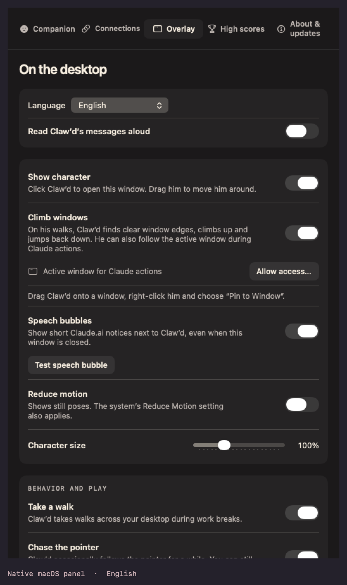
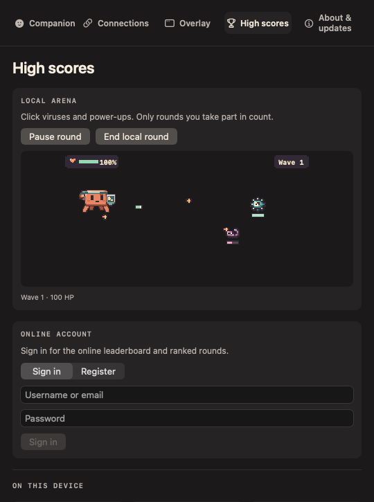
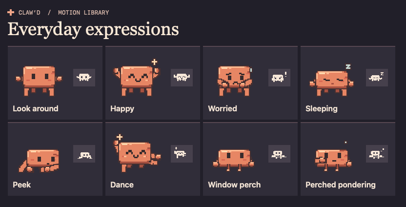
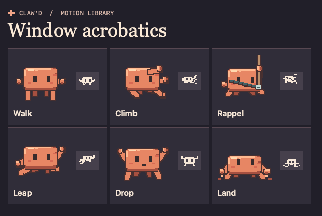

<p align="center"></p>

# Claw’d Companion

**Deutsch** · [English](docs/README.en.md) · [简体中文](docs/README.zh-Hans.md) · [हिन्दी](docs/README.hi.md) · [Español](docs/README.es.md) · [العربية](docs/README.ar.md) · [Français](docs/README.fr.md) · [বাংলা](docs/README.bn.md) · [Português](docs/README.pt.md) · [Bahasa Indonesia](docs/README.id.md) · [اردو](docs/README.ur.md)

Ein Pixelkrebs für deinen Schreibtisch. Claw’d schaut vom Notebook auf, wenn Claude deine Aufmerksamkeit braucht, folgt deinem Mauszeiger mit den Augen und sucht sich zwischen zwei Antworten eine Fensterkante zum Ausruhen.

[**v0.6.1**](https://github.com/ZUMBYTE-AppSolution/clawd-companion/releases/tag/v0.6.1) · macOS · Windows · Linux · [Zumbyte · AppSolution](https://zumbyte.de/)

## Neu in 0.6.1

Auf dem Mac kann Claw’d das verbleibende Kontingent jetzt direkt aus der Nutzungsansicht von Claude Desktop übernehmen. In der Kontingentanzeige hat die Claude-App eine eigene Quelle neben Claude.ai und Claude Code. Auf Mac, Windows und Linux kannst du unter **Highscores → Lokale Runde starten** jederzeit offline spielen.

[Neu in 0.6.1](docs/releases/0.6.1/de.md)

## Einblicke


| Overlay-Einstellungen | Verbindungen |
| --- | --- |
|  |  |

| Info & Updates | Highscores und Arena-Konto |
| --- | --- |
|  |  |



Das Update-Fenster wurde ohne Netzabfrage aufgenommen. Der Highscore-Screenshot zeigt die native Ranglistenansicht mit einer lokalen Beispiel-Sitzung und erfundenen Spieldaten.

Die Screenshots zeigen die englische Mac-Oberfläche mit Beispieldaten zum Kontingent. Die Browser-Konsole ist eine lokale Nachstellung. [↗](docs/media/CAPTURES.md)

## Installation

Ab macOS 13 öffnest du das universelle PKG oder entpackst die App und ziehst sie nach Programme. Unter Windows x64 startest du das Setup oder entpackst die portable ZIP vor dem Öffnen der EXE. Für Linux x86-64 stehen DEB, RPM und ein tar-Archiv zur Auswahl. Die Release-Seite führt die für dein System hochgeladenen Dateien auf.

macOS unterstützt Apple Silicon und Intel. Die gezeigten Fensteraktionen, Berechtigungen und Claude-Code-Anbindungen beziehen sich auf die native Mac-App. Unter Linux hängt die Desktop-Integration auch vom Fenstersystem ab.

Windows und Linux verwenden Qt. Unter Windows und X11 kann Claw’d die Position des aktiven Fensters lesen und daran haften. Unter Wayland entfällt der Fenster-Pin. Dort nutzt die Leerlaufautomatik den GNOME IdleMonitor, sofern er verfügbar ist. Ohne Leerlaufsignal wartet die Arena auf eine ausdrücklich erlaubte aktive Runde.

| OS | Installation |
| --- | --- |
| macOS | [PKG](https://github.com/ZUMBYTE-AppSolution/clawd-companion/releases/download/v0.6.1/Clawd-Companion-0.6.1-macOS-universal.pkg) · [ZIP](https://github.com/ZUMBYTE-AppSolution/clawd-companion/releases/download/v0.6.1/Clawd-Companion-0.6.1-macOS-universal.zip) |
| Windows x64 | [Setup](https://github.com/ZUMBYTE-AppSolution/clawd-companion/releases/download/v0.6.1/Clawd-Companion-0.6.1-Windows-x64-Setup.exe) · [Portable ZIP](https://github.com/ZUMBYTE-AppSolution/clawd-companion/releases/download/v0.6.1/Clawd-Companion-0.6.1-Windows-x64-Portable.zip) |
| Linux x86-64 | [DEB](https://github.com/ZUMBYTE-AppSolution/clawd-companion/releases/download/v0.6.1/clawd-companion_0.6.1_amd64.deb) · [RPM](https://github.com/ZUMBYTE-AppSolution/clawd-companion/releases/download/v0.6.1/clawd-companion-0.6.1-1.x86_64.rpm) · [tar.gz](https://github.com/ZUMBYTE-AppSolution/clawd-companion/releases/download/v0.6.1/Clawd-Companion-0.6.1-Linux-x86_64.tar.gz) |

[SHA256SUMS](https://github.com/ZUMBYTE-AppSolution/clawd-companion/releases/download/v0.6.1/SHA256SUMS) · [GitHub Releases](https://github.com/ZUMBYTE-AppSolution/clawd-companion/releases)

**macOS · Homebrew**

```sh
brew tap zumbyte/clawd https://github.com/ZUMBYTE-AppSolution/clawd-companion
brew install --cask zumbyte/clawd/clawd-companion
```

**Debian / Ubuntu**

```sh
sudo apt install ./clawd-companion_0.6.1_amd64.deb
```

**Fedora / RHEL**

```sh
sudo dnf install ./clawd-companion-0.6.1-1.x86_64.rpm
```

## Wenn Claude arbeitet

| Sichtbares Ereignis | Claw’ds Reaktion |
| --- | --- |
| Claude schreibt oder bearbeitet Text | Tippt auf seinem kleinen Notebook. |
| Planen, Suchen oder Lesen | Zeichnet einen Plan am Flipchart, untersucht Quellen mit der Lupe oder öffnet eine Mappe. |
| Codeausführung oder ein neues Artefakt | Öffnet sein Mini-Terminal oder zeichnet an der Staffelei. |
| Ein Werkzeug braucht deine Freigabe | Entrollt ein „OK?“-Schild und hält es bis zur Klärung hoch. Die Antwort gibst du in Claude. |
| Claude Code meldet Subagents | Jongliert mit Agentenfiguren. Im Status steht die tatsächliche Anzahl. |
| Eine Antwort endet oder eine Warnung erscheint | Seilt sich ab und freut sich über die fertige Antwort oder zeigt den Warntext in einer Pixel-Sprechblase. |

## Claude Desktop verbinden (macOS)

1. Öffne in Claw’d **Verbindungen** und schalte die Verbindung zu **Claude Desktop** ein.
2. Klicke auf **Zugriff erlauben …**. Aktiviere **Claw’d Companion** in den macOS-Systemeinstellungen unter **Datenschutz & Sicherheit → Bedienungshilfen**.
3. Öffne in der **Claude-App** auf dem Mac **Einstellungen → Nutzung** und lass die Seite kurz geöffnet. Mit **Jetzt einlesen** kannst du die Ansicht erneut prüfen lassen.

Alternativ öffnest du in Claude neben dem Eingabefeld das Menü **Nutzung**. Im geöffneten Menü kann Claw’d die angezeigten Zeitfenster lesen. Bei geschlossenem Menü liefert die Schaltfläche nur den ausdrücklich bezeichneten Zeitraum, etwa das Wochenlimit.

Claw’d liest die verbleibenden Prozente für das Sitzungs- oder Wochenlimit und die Rücksetzzeit, soweit Claude diese Werte in einer unterstützten Form anzeigt. Öffne die Nutzungsansicht erneut, wenn du einen aktuellen Stand brauchst.

Beim Einschalten wählt Claw’d automatisch **Claude Desktop** als Kontingentquelle. Die letzte gültige Messung behält ihren ursprünglichen Zeitstempel. Eine später unter **Begleiter → Kontingent** getroffene Quellenwahl bleibt beim nächsten Start erhalten.

[Apple](https://support.apple.com/guide/mac-help/allow-accessibility-apps-to-access-your-mac-mh43185/mac) · [Claude](https://support.claude.com/en/articles/17007452-what-is-a-limit-reset)

## Claude.ai verbinden

Aktiviere unter Verbindungen die Browser-Verbindung. In Chrome, Edge oder Brave schaltest du den Entwicklermodus ein und wählst über „Entpackte Erweiterung laden“ den mitgelieferten Ordner BrowserExtension. Füge den Kopplungscode aus der App im Erweiterungsmenü ein und lade den Claude.ai-Tab neu. Auf dem Mac ist auch eine Safari-Erweiterung enthalten. Aktiviere sie und erlaube den Zugriff auf claude.ai.

Öffne im gekoppelten Browser die Nutzungsseite. Sobald Claude dort Sitzungs- oder Wochenwerte anzeigt, kann Claw’d Restprozente, Rücksetzzeit und Zeitpunkt der Messung anzeigen. Relative Zeiten sind Näherungen. Fehlende oder abgelaufene Werte bleiben offen. Die Erweiterung erkennt sichtbare Aktionen und Hinweise im geöffneten Tab und gibt sie über die lokale Kopplung weiter.

[Claude.ai](https://claude.ai/settings/usage) · [Safari](https://developer.apple.com/documentation/safariservices/running-your-safari-web-extension)

### Eine Sprechblase in der Browser-Konsole ausprobieren

Im gekoppelten Claude.ai-Tab erzeugt dieses Beispiel einen kurzen, sichtbaren Hinweis. Die Erweiterung gibt seinen Text an Claw’d weiter. Das Beispiel läuft lokal. Auch die abgebildete Browsersequenz nutzt nachgestellte Ereignisse.

```js
(() => {
  const notice = document.createElement("div");
  notice.setAttribute("role", "alert");
  notice.textContent = "Claw’d pixel bubble test";
  Object.assign(notice.style, {
    position: "fixed", top: "1rem", right: "1rem", zIndex: "2147483647",
    background: "#fff", color: "#222", padding: "0.75rem"
  });
  document.body.append(notice);
  setTimeout(() => notice.remove(), 4000);
})();
```


**Claude.ai → Claw’d · JSON**

```jsonl
{"type":"activity","state":"planning"}
{"type":"activity","state":"executing"}
{"type":"activity","state":"done"}
```

## Fensterspaziergänge, Cursorspiele und Virenarena

Ziehe Claw’d auf dem Mac an ein Fenster und wähle per Rechtsklick „Pin to Window“. Beim Verschieben bleibt er an seinem Platz und kann sich von dort abseilen. Unterwegs klettert er auf Titelleisten, schaut sich um, blinzelt und springt herunter. Seine Augen folgen deinem Cursor. Der Buchstabenblaster zielt bei jedem der zufällig 3 bis 42 Schüsse neu. Ein Treffer zählt bei Kontakt mit einem sichtbaren Geschoss.

Die automatische Desktop-Runde auf dem Mac kann nach mindestens 90 Sekunden ohne Eingabe beginnen. Claw’d hat 100 Lebenspunkte. Zwei zufällige Wellen führen zum Endboss. Beobachte die gegnerischen Lebensbalken und sammle Heilung, Schilde oder Schnellfeuer. Bei Eingaben pausiert das Spiel. Mit „Auch bei aktiver Nutzung spielen“ kannst du per Mausklick mithelfen. Nach einer Niederlage steht fünf echte Minuten lang ein GIT-Grabstein an seiner Stelle. Dann gräbt er sich wieder aus. Musik und Effekte lassen sich einzeln schalten.

Wähle in den Overlay-Einstellungen die Sprache, reduzierte Bewegung und die Lautstärke. Eigene Töne lassen sich einzeln ausschalten. Claude.ai-Hinweise behalten ihren ursprünglichen Wortlaut.

Du kannst die Virenarena auf Mac, Windows und Linux direkt unter **Highscores → Lokale Runde starten** spielen. Die lokale Runde läuft auch offline und ohne Konto. Du startest sie jederzeit selbst, unabhängig vom Leerlauf. Deine Einstellungen für das automatische Spiel bleiben erhalten. Für deine lokale Statistik zählen nur abgeschlossene Runden, in denen du selbst einen Gegner getroffen oder ein wirksames Power-up eingesammelt hast. Die Online-Rangliste wertet ausschließlich angemeldete Serverrunden.

## Highscores und Arena-Konto

Unter Highscores siehst du deine lokale Bilanz mit Punkten, Kills, Toden, K/D und Siegen. Dafür zählen abgeschlossene Runden mit persönlichem Treffer oder wirksamem Power-up. Für die Online-Rangliste registrierst du ein eigenes Arena-Konto mit Benutzernamen, E-Mail und Passwort und meldest dich in der App an. Eine gewertete Runde startest du selbst. Der Server bestätigt deine Aktionen und berechnet das Ergebnis. Die Rangliste zeigt deinen Benutzernamen und deine Spielwerte. Deine E-Mail bleibt privat. Für das Online-Spiel muss der Spielserver erreichbar sein.

## Animationsgalerie

| Gefühle und Spiele | Bewegung an Fenstern |
| --- | --- |
|  |  |

| Claude-Werkzeuge und Freigaben | Kampf, Grab und Auferstehung |
| --- | --- |
|  |  |


▶ [Die Arena mit Ton ansehen. Der Film kürzt die fünf Minuten am Grab ab.](docs/media/virus-arena.mp4)

## Updates und lokale Entwicklung

Die App prüft beim Start und danach täglich die GitHub-Release-Daten. Gibt es eine neue Version, führt dich der Hinweis zu den Änderungen und zum Download für dein System.

Unter „Info & Updates“ findest du neue Versionen und ihre Pakete. Installiere das heruntergeladene Paket wie oben beschrieben. In den Verbindungen der Mac-App kannst du Claude-Code-Aktivität und Kontingent separat einschalten. Starte anschließend eine neue Claude-Code-Sitzung. Browser und Terminal behalten getrennte Messwerte.

Die Mac-App nutzt Swift und AppKit. Mit installiertem Xcode baust du sie aus dem Stammverzeichnis. Die JavaScript-Tests verwenden lokale Browser-Testdaten. Der portable Desktop-Client liegt unter Desktop.

```sh
./Scripts/build-mac.sh
swift test
node --test BrowserTests/*.test.js
python3 Scripts/test-hooks.py
```

[Swift](Package.swift) · [Desktop](Desktop/) · [Claude Code](https://code.claude.com/docs/en/hooks) · [Status line](https://code.claude.com/docs/en/statusline)

[Windows](Scripts/package-windows.ps1) · [Linux](Scripts/package-linux.sh)

## Studio und Community

Andreas Zumbansen führt Zumbyte · AppSolution in Kamen. Das unabhängige Studio entwickelt mobile Apps, Desktop-Anwendungen und individuelle Software für Unternehmen und Teams.

Zumbyte · AppSolution · Kastanienallee 16a · 59174 Kamen · DE · +49 177 4149667

[Zumbyte](https://zumbyte.de/) · [Impressum](https://zumbyte.de/impressum/) · [info@zumbyte.de](mailto:info@zumbyte.de)

Liebe Grüße an die gesamte AI Coding Community. Danke fürs Bauen, Teilen und gegenseitige Helfen!

[Ausführliches Mac-Handbuch](docs/macos-de.md)
