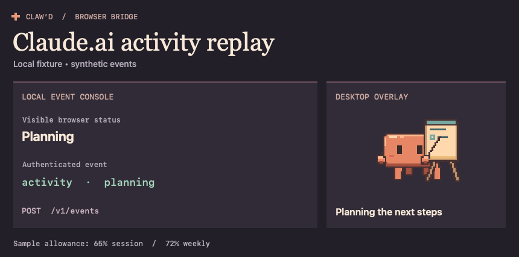

<p align="center"></p>

# Claw’d Companion

[Deutsch](../README.md) · [English](README.en.md) · [简体中文](README.zh-Hans.md) · [हिन्दी](README.hi.md) · [Español](README.es.md) · **العربية** · [Français](README.fr.md) · [বাংলা](README.bn.md) · [Português](README.pt.md) · [Bahasa Indonesia](README.id.md) · [اردو](README.ur.md)

سلطعون صغير من البكسلات يسكن سطح مكتبك. يرفع Claw’d رأسه عن حاسوبه عندما يحتاج Claude إلى انتباهك، ويتابع المؤشر بعينيه، ثم يجد حافة نافذة يجلس عليها بين إجابتين.

[**v0.6.0**](https://github.com/ZUMBYTE-AppSolution/clawd-companion/releases/tag/v0.6.0) · macOS · Windows · Linux · [Zumbyte · AppSolution](https://zumbyte.de/)

## الجديد في الإصدار 0.6.0

تنضم حزم Windows وLinux إلى تطبيق Mac. من «حول التطبيق والتحديثات» يمكنك البحث عن إصدار جديد وقراءة تغييراته واختيار الحزمة المناسبة.

[الجديد في الإصدار 0.6.0](releases/0.6.0/ar.md)

## جولة في التطبيق


| إعدادات الطبقة العائمة | الاتصالات |
| --- | --- |
|  |  |

| حول التطبيق والتحديثات | أعلى النتائج وحساب الساحة |
| --- | --- |
|  |  |

صُوّرت لوحة التحديثات دون إجراء طلب عبر الشبكة. وتعرض صورة النتائج واجهة الترتيب الأصلية مع جلسة اختبار محلية ونتائج تمثيلية.

تعرض الصور واجهة Mac بالإنجليزية مع قراءات تجريبية للحصة. ومشهد وحدة تحكم المتصفح إعادة تمثيل محلية. [↗](media/CAPTURES.md)

## التثبيت

على macOS 13 أو أحدث، افتح حزمة PKG الشاملة أو فك ضغط التطبيق وانقله إلى مجلد التطبيقات. على Windows x64 شغّل برنامج التثبيت أو فك ضغط ملف ZIP المحمول قبل فتح الملف التنفيذي. على Linux x86-64 استخدم حزمة DEB أو RPM أو أرشيف tar. تعرض صفحة الإصدار الملفات المرفوعة لكل نظام.

يدعم تطبيق Mac أجهزة Apple Silicon وIntel. تخص أمثلة النوافذ والأذونات وربط Claude Code أدناه تطبيق Mac الأصلي. وعلى Linux يتأثر التكامل أيضًا بنظام النوافذ المستخدم.

يستخدم إصدارا Windows وLinux إطار Qt. في Windows وX11 يستطيع Claw’d قراءة موضع النافذة النشطة وأبعادها والتثبّت عليها. تثبيت النوافذ غير متاح في Wayland. هناك يستعين كشف الخمول بخدمة GNOME IdleMonitor عند توفرها. من دون إشارة خمول ينتظر اللعب إذنك الصريح للتشغيل أثناء الاستخدام.

| OS | التثبيت |
| --- | --- |
| macOS | [PKG](https://github.com/ZUMBYTE-AppSolution/clawd-companion/releases/download/v0.6.0/Clawd-Companion-0.6.0-macOS-universal.pkg) · [ZIP](https://github.com/ZUMBYTE-AppSolution/clawd-companion/releases/download/v0.6.0/Clawd-Companion-0.6.0-macOS-universal.zip) |
| Windows x64 | [Setup](https://github.com/ZUMBYTE-AppSolution/clawd-companion/releases/download/v0.6.0/Clawd-Companion-0.6.0-Windows-x64-Setup.exe) · [Portable ZIP](https://github.com/ZUMBYTE-AppSolution/clawd-companion/releases/download/v0.6.0/Clawd-Companion-0.6.0-Windows-x64-Portable.zip) |
| Linux x86-64 | [DEB](https://github.com/ZUMBYTE-AppSolution/clawd-companion/releases/download/v0.6.0/clawd-companion_0.6.0_amd64.deb) · [RPM](https://github.com/ZUMBYTE-AppSolution/clawd-companion/releases/download/v0.6.0/clawd-companion-0.6.0-1.x86_64.rpm) · [tar.gz](https://github.com/ZUMBYTE-AppSolution/clawd-companion/releases/download/v0.6.0/Clawd-Companion-0.6.0-Linux-x86_64.tar.gz) |

[SHA256SUMS](https://github.com/ZUMBYTE-AppSolution/clawd-companion/releases/download/v0.6.0/SHA256SUMS) · [GitHub Releases](https://github.com/ZUMBYTE-AppSolution/clawd-companion/releases)

**macOS · Homebrew**

```sh
brew tap zumbyte/clawd https://github.com/ZUMBYTE-AppSolution/clawd-companion
brew install --cask zumbyte/clawd/clawd-companion
```

**Debian / Ubuntu**

```sh
sudo apt install ./clawd-companion_0.6.0_amd64.deb
```

**Fedora / RHEL**

```sh
sudo dnf install ./clawd-companion-0.6.0-1.x86_64.rpm
```

## أثناء عمل Claude

| الحدث الظاهر | استجابة Claw’d |
| --- | --- |
| يكتب Claude أو يحرر النص | يكتب على حاسوبه المحمول الصغير. |
| تخطيط أو بحث أو قراءة | يرسم خطة على اللوح الورقي أو يتفحص المصادر بعدسة مكبرة أو يفتح مجلدًا. |
| تشغيل شفرة أو إنشاء عمل | يستخدم طرفية مصغرة أو يرسم على حامل اللوحات. |
| تطلب أداة إذنًا | يفرد لافتة «OK?» حتى يُحسم الطلب. أجب داخل Claude. |
| يبلغ Claude Code عن وكلاء فرعيين | يتلاعب بدمى الوكلاء في الهواء. وتعرض الحالة عددهم الفعلي. |
| تكتمل إجابة أو يظهر تحذير | ينزل بالحبل محتفلًا بانتهاء الإجابة، أو يعرض نص التحذير في فقاعة كلام من البكسلات. |

## ربط Claude.ai

فعّل اتصال المتصفح في «الاتصالات». في Chrome أو Edge أو Brave فعّل وضع المطور، ثم اختر تحميل إضافة غير مُعبّأة وحدد مجلد BrowserExtension المرفق. الصق رمز الإقران من التطبيق في نافذة الإضافة وأعد تحميل تبويب Claude.ai. يشمل تطبيق Mac إضافة Safari أيضًا. فعّلها واسمح لها بالوصول إلى claude.ai.

افتح صفحة الاستخدام في المتصفح المقترن. إذا أظهر Claude حصة الجلسة أو الأسبوع، يستطيع Claw’d عرض النسبة المتبقية وموعد إعادة الضبط ووقت آخر قراءة. المواعيد النسبية تقريبية، وتبقى القراءات الغائبة أو المنتهية فارغة. تنقل الإضافة الأنشطة والتنبيهات الظاهرة في التبويبات المفتوحة عبر اتصال محلي.

[Claude.ai](https://claude.ai/settings/usage) · [Safari](https://developer.apple.com/documentation/safariservices/running-your-safari-web-extension)

### جرّب فقاعة كلام من وحدة تحكم المتصفح

يضيف هذا المثال تنبيهًا مؤقتًا مرئيًا إلى تبويب Claude.ai المقترن، وتنقل الإضافة نصه إلى Claw’d. يجري العرض محليًا، ويستخدم تسلسل المتصفح المصوّر أحداثًا تمثيلية أيضًا.

```js
(() => {
  const notice = document.createElement("div");
  notice.setAttribute("role", "alert");
  notice.textContent = "Claw’d pixel bubble test";
  Object.assign(notice.style, {
    position: "fixed", top: "1rem", right: "1rem", zIndex: "2147483647",
    background: "#fff", color: "#222", padding: "0.75rem"
  });
  document.body.append(notice);
  setTimeout(() => notice.remove(), 4000);
})();
```



**Claude.ai → Claw’d · JSON**

```jsonl
{"type":"activity","state":"planning"}
{"type":"activity","state":"executing"}
{"type":"activity","state":"done"}
```

## التجول على النوافذ وألعاب المؤشر وساحة الفيروسات

على Mac اسحب Claw’d إلى نافذة وانقر عليه بالزر الأيمن واختر Pin to Window. يظل مثبتًا في مكانه عندما تتحرك النافذة ويمكنه النزول منه بالحبل. أثناء التجول يتسلق أشرطة العناوين ويتلفت ويطرف بعينيه ويقفز إلى الأسفل. تتابع عيناه المؤشر. تعيد قاذفة الأحرف التصويب عند كل طلقة في دفعة عشوائية من 3 إلى 42 طلقة. تُحسب الإصابة عند ملامسة المؤشر لمقذوف ظاهر.

على Mac يمكن أن تبدأ الساحة بعد مرور 90 ثانية على الأقل دون إدخال. لدى Claw’d مئة نقطة صحة. بعد موجتين عشوائيتين يصل الزعيم الأخير. راقب أشرطة صحة الخصوم واجمع العلاج أو الدروع أو إطلاق النار السريع. يتوقف اللعب عند استخدام الفأرة أو لوحة المفاتيح. فعّل اللعب أثناء الاستخدام لتساعد بالنقر. عند الهزيمة يظهر شاهد قبر كُتب عليه GIT لخمس دقائق فعلية، ثم يحفر Claw’d طريقه إلى الخارج. يمكنك التحكم في الموسيقى والمؤثرات الصوتية كل على حدة.

اختر اللغة وخفض الحركة ومستوى الصوت في إعدادات الطبقة العائمة. يمكنك كتم كل مؤثر على حدة. تحتفظ إشعارات Claude.ai بنصها الأصلي.

## أعلى النتائج وحساب الساحة

تعرض أعلى النتائج نقاطك المحلية وعدد الخصوم الذين هزمتهم ومرات الموت والنسبة بينهما والانتصارات. تُحتسب الجولة المكتملة إذا أصبت خصمًا بنفسك أو جمعت معززًا له أثر. للانضمام إلى لوحة المتصدرين، أنشئ حسابًا خاصًا بالساحة باستخدام اسم مستخدم وبريد إلكتروني وكلمة مرور ثم ادخل من التطبيق. تبدأ الجولة المصنّفة بنفسك، ويؤكد الخادم إجراءاتك ويحسب النتيجة. تعرض اللوحة اسم المستخدم وإحصاءات اللعب ويبقى بريدك خاصًا. يتطلب اللعب عبر الإنترنت اتصالًا بخادم اللعبة.

## معرض الرسوم المتحركة

| التعابير والألعاب | التنقل على النوافذ |
| --- | --- |
|  |  |

| أدوات Claude والأذونات | القتال والقبر والعودة إلى الحياة |
| --- | --- |
|  |  |


▶ [شاهد الساحة مع الصوت. يختصر الفيديو دقائق الانتظار الخمس عند القبر.](media/virus-arena.mp4)

## التحديثات والتطوير المحلي

يفحص التطبيق معلومات الإصدارات على GitHub عند التشغيل ثم يوميًا. ينقلك تنبيه الإصدار الجديد إلى التغييرات والتنزيل المناسب لنظامك.

ابحث عن إصدار جديد في «حول التطبيق والتحديثات»، واختر الحزمة وثبّتها بالطريقة الموضحة أعلاه. على Mac يمكنك تفعيل أحداث Claude Code وقراءات الحصة بصورة مستقلة من «الاتصالات». ابدأ جلسة Claude Code جديدة بعد الإعداد. يحتفظ كل من المتصفح والطرفية بقراءاته الخاصة.

يستخدم تطبيق Mac لغتي Swift وإطار AppKit. ثبّت Xcode ثم ابنِ التطبيق من جذر المستودع. تستخدم اختبارات JavaScript بيانات متصفح محلية. يوجد عميل سطح المكتب المحمول في مجلد Desktop.

```sh
./Scripts/build-mac.sh
swift test
node --test BrowserTests/*.test.js
python3 Scripts/test-hooks.py
```

[Swift](../Package.swift) · [Desktop](../Desktop/) · [Claude Code](https://code.claude.com/docs/en/hooks) · [Status line](https://code.claude.com/docs/en/statusline)

[Arena API](../Server/README.md) · [Windows](../Scripts/package-windows.ps1) · [Linux](../Scripts/package-linux.sh)

## الاستوديو والمجتمع

يدير Andreas Zumbansen استوديو Zumbyte · AppSolution في كامن بألمانيا. يطوّر الاستوديو المستقل تطبيقات للجوال وسطح المكتب وبرمجيات حسب احتياجات الشركات والفرق.

Zumbyte · AppSolution · Kastanienallee 16a · 59174 Kamen · DE · +49 177 4149667

[Zumbyte](https://zumbyte.de/) · [البيانات القانونية](https://zumbyte.de/impressum/) · [info@zumbyte.de](mailto:info@zumbyte.de)

أطيب التحيات لكل من يبرمج بمساعدة الذكاء الاصطناعي. شكرًا لكم على ما تبنونه وتشاركونه وعلى مساعدة بعضكم بعضًا!
