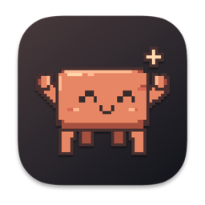
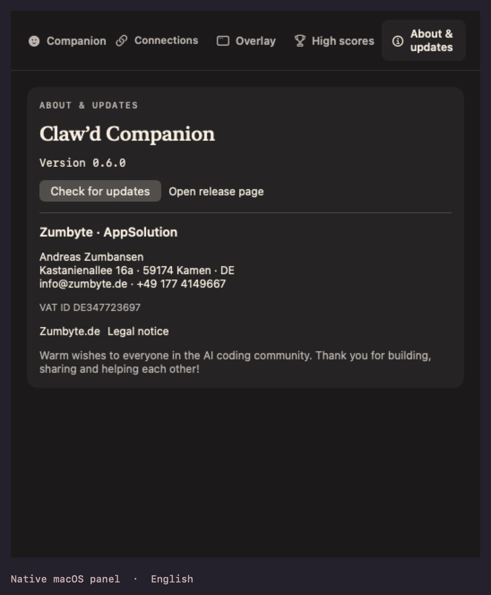

<p align="center"></p>

# Claw’d Companion

[Deutsch](../README.md) · **English** · [简体中文](README.zh-Hans.md) · [हिन्दी](README.hi.md) · [Español](README.es.md) · [العربية](README.ar.md) · [Français](README.fr.md) · [বাংলা](README.bn.md) · [Português](README.pt.md) · [Bahasa Indonesia](README.id.md) · [اردو](README.ur.md)

A pixel crab for your desktop. Claw’d looks up from his notebook when Claude needs your attention, watches your cursor and finds a window ledge to rest on between replies.

[**v0.7.1**](https://github.com/ZUMBYTE-AppSolution/clawd-companion/releases/tag/v0.7.1) · macOS · Windows · Linux · [Zumbyte · AppSolution](https://zumbyte.de/)

## Endless arena · 0.7.1

Choose Light, Dark or Follow system under **Overlay → Appearance**. Changes take effect immediately and persist after restart. On Linux, the Wayland companion window, tabs, menus and form fields now use matching colors.

Open the maximized arena from High scores. Move with WASD or the arrow keys. Claw’d fires automatically. Each level has four waves and a boss.

Start with three lives and earn one more every two completed levels. Combine piercing shots, multishot and blast damage. Your best level and wave are saved on this device.

<p> </p>

## Inside the app


| Overlay settings | Connections |
| --- | --- |
|  |  |

| About & updates | High scores and arena accounts |
| --- | --- |
|  |  |


The update panel was captured without making a network request. The high scores image shows the native leaderboard with a local test session and sample scores.

The screenshots show the Mac interface in English with sample quota readings. The browser console is a local replay. [↗](media/CAPTURES.md)

## Install

On macOS 13 or later, open the universal PKG or unzip the app and move it to Applications. On Windows x64, run Setup or extract the portable ZIP before opening the executable. Linux x86-64 users can install a DEB or RPM, or extract the tarball. The release page lists the files uploaded for your platform.

macOS supports Apple Silicon and Intel. The illustrated window, permission and Claude Code workflows below refer to the native Mac app. On Linux, desktop integration also depends on the window system.

Windows and Linux use Qt. On Windows and X11, Claw’d can read foreground window geometry and attach to a window. Window pinning is unavailable on Wayland. On Wayland, automatic idle play uses GNOME IdleMonitor when available. Without an idle signal, the arena waits for explicitly enabled active play.

| OS | Install |
| --- | --- |
| macOS | [PKG](https://github.com/ZUMBYTE-AppSolution/clawd-companion/releases/download/v0.7.1/Clawd-Companion-0.7.1-macOS-universal.pkg) · [ZIP](https://github.com/ZUMBYTE-AppSolution/clawd-companion/releases/download/v0.7.1/Clawd-Companion-0.7.1-macOS-universal.zip) |
| Windows x64 | [Setup](https://github.com/ZUMBYTE-AppSolution/clawd-companion/releases/download/v0.7.1/Clawd-Companion-0.7.1-Windows-x64-Setup.exe) · [Portable ZIP](https://github.com/ZUMBYTE-AppSolution/clawd-companion/releases/download/v0.7.1/Clawd-Companion-0.7.1-Windows-x64-Portable.zip) |
| Linux x86-64 | [DEB](https://github.com/ZUMBYTE-AppSolution/clawd-companion/releases/download/v0.7.1/clawd-companion_0.7.1_amd64.deb) · [RPM](https://github.com/ZUMBYTE-AppSolution/clawd-companion/releases/download/v0.7.1/clawd-companion-0.7.1-1.x86_64.rpm) · [tar.gz](https://github.com/ZUMBYTE-AppSolution/clawd-companion/releases/download/v0.7.1/Clawd-Companion-0.7.1-Linux-x86_64.tar.gz) |

[SHA256SUMS](https://github.com/ZUMBYTE-AppSolution/clawd-companion/releases/download/v0.7.1/SHA256SUMS) · [GitHub Releases](https://github.com/ZUMBYTE-AppSolution/clawd-companion/releases)

**macOS · Homebrew**

```sh
brew tap zumbyte/clawd https://github.com/ZUMBYTE-AppSolution/clawd-companion
brew install --cask zumbyte/clawd/clawd-companion
```

**Debian / Ubuntu**

```sh
sudo apt install ./clawd-companion_0.7.1_amd64.deb
```

**Fedora / RHEL**

```sh
sudo dnf install ./clawd-companion-0.7.1-1.x86_64.rpm
```

## What Claude does on screen

| Visible event | Claw’d’s response |
| --- | --- |
| Claude writes or edits | Taps the keys on his little notebook. |
| Planning, searching or reading | Draws a plan on a flip chart, peers through a magnifier or opens a folder. |
| Running code or creating an artifact | Works at a tiny terminal or draws on an easel. |
| A tool asks for approval | Unrolls an “OK?” sign until the request clears. Answer the request in Claude. |
| Claude Code reports subagents | Juggles agent figures. The status shows the actual count. |
| A reply finishes or a warning appears | Rappels and celebrates a completed reply, or shows the warning text in a pixel speech bubble. |

## Connect Claude Desktop (macOS)

1. Open **Connections** in Claw’d and enable the **Claude Desktop** connection.
2. Choose **Allow access…**. In macOS **System Settings → Privacy & Security → Accessibility**, turn on **Claw’d Companion**.
3. In the **Claude app** on your Mac, open **Settings → Usage** and leave the page open for a moment. Choose **Read now** in Claw’d to check the view again.

You can also open **Usage** beside the message box in Claude. With the menu open, Claw’d can read the usage windows it displays. When it is closed, the button supplies only the period named on its label, such as the weekly limit.

Claw’d reads the remaining percentage for a session or weekly limit and the reset time when Claude displays those values in a supported form. Reopen the usage view whenever you need a fresh reading.

Enabling the connection selects **Claude Desktop** as the quota source. The last valid reading keeps its original timestamp. If you later choose another source under **Companion → Usage limits**, Claw’d remembers that choice after a restart.

[Apple](https://support.apple.com/guide/mac-help/allow-accessibility-apps-to-access-your-mac-mh43185/mac) · [Claude](https://support.claude.com/en/articles/17007452-what-is-a-limit-reset)

## Connect Claude.ai

Turn on the browser connection under Connections. In Chrome, Edge or Brave, enable developer mode, choose Load unpacked and select the supplied BrowserExtension folder. Paste the app’s pairing code in the extension popup and reload your Claude.ai tab. On Mac, the app also includes a Safari extension. Enable it and grant access to claude.ai.

Open the usage page in the paired browser. When Claude shows a session or weekly allowance, Claw’d can display the remaining percentage, reset time and last reading. Relative reset times are approximate. Missing or expired readings stay empty. The app uses visible activity labels and notices from open tabs. A local pairing code connects them to the companion.

[Claude.ai](https://claude.ai/settings/usage) · [Safari](https://developer.apple.com/documentation/safariservices/running-your-safari-web-extension)

### Try a speech bubble in the browser console

In a paired Claude.ai tab, this snippet adds a temporary, visible alert to the page. The extension passes its text to Claw’d. This is a local demonstration. The illustrated browser sequence also uses staged events.

```js
(() => {
  const notice = document.createElement("div");
  notice.setAttribute("role", "alert");
  notice.textContent = "Claw’d pixel bubble test";
  Object.assign(notice.style, {
    position: "fixed", top: "1rem", right: "1rem", zIndex: "2147483647",
    background: "#fff", color: "#222", padding: "0.75rem"
  });
  document.body.append(notice);
  setTimeout(() => notice.remove(), 4000);
})();
```


**Claude.ai → Claw’d · JSON**

```jsonl
{"type":"activity","state":"planning"}
{"type":"activity","state":"executing"}
{"type":"activity","state":"done"}
```

## Window walks, cursor games and the virus arena

On Mac, drag Claw’d to a window, right-click and choose Pin to Window. He keeps his place as the window moves and can rappel from it. While roaming, he climbs to title bars, looks around, blinks and jumps down. His eyes track the pointer. The letter blaster retargets every shot of a random 3–42-shot burst. The counter records contact with a visible projectile.

An automatic desktop round on Mac can start after at least 90 seconds without input. Claw’d has 100 HP. Two randomized waves lead to a boss. Watch the enemies’ health bars and collect healing, shields or rapid fire. Input pauses the game. Enable play during activity to help by clicking. After defeat, a GIT headstone marks his place for five real minutes before he digs himself out. Music and effects have separate switches.

Choose a language, reduced motion and volume in the overlay settings. Each sound can be muted separately. Claude.ai notices keep their original wording.

## High scores and arena accounts

High scores shows your local points, kills, deaths, K/D and wins. A finished round counts when you personally hit an enemy or collect an effective power-up. To join the online leaderboard, register a separate arena account with a username, email and password, then sign in through the app. Start a ranked round yourself. The server confirms actions and computes the result. The leaderboard displays your username and game statistics. Your email stays private. Online play requires a reachable game server.

## Animation gallery

| Expressions and play | Window movement |
| --- | --- |
|  |  |

| Claude tools and approvals | Fight, grave and revival |
| --- | --- |
|  |  |


▶ [Watch the arena with sound. The film cuts the five-minute wait at the grave.](media/virus-arena.mp4)

## Updates and local development

The app checks GitHub release metadata at launch and then daily. When a newer version is available, the notice leads to its changes and the download for your system.

Use About & updates to check for a new version and choose a package. Install the downloaded package using the same method as above. In the Mac app, Claude Code activity hooks and quota reporting can be enabled independently in Connections. Start a new Claude Code session after setup. The browser and terminal keep separate readings.

The Mac app uses Swift and AppKit. Build it from the repository root with Xcode installed. The JavaScript tests use local browser fixtures. The portable desktop client lives in Desktop.

```sh
./Scripts/build-mac.sh
swift test
node --test BrowserTests/*.test.js
python3 Scripts/test-hooks.py
```

[Swift](../Package.swift) · [Desktop](../Desktop/) · [Claude Code](https://code.claude.com/docs/en/hooks) · [Status line](https://code.claude.com/docs/en/statusline)

[Windows](../Scripts/package-windows.ps1) · [Linux](../Scripts/package-linux.sh)

## Studio and community

Andreas Zumbansen runs Zumbyte · AppSolution in Kamen, Germany. The independent studio develops mobile and desktop apps as well as custom software for businesses and teams.

Zumbyte · AppSolution · Kastanienallee 16a · 59174 Kamen · DE · +49 177 4149667

[Zumbyte](https://zumbyte.de/) · [Legal notice](https://zumbyte.de/impressum/) · [info@zumbyte.de](mailto:info@zumbyte.de)

Warm wishes to everyone in the AI coding community. Thank you for building, sharing and helping each other!
