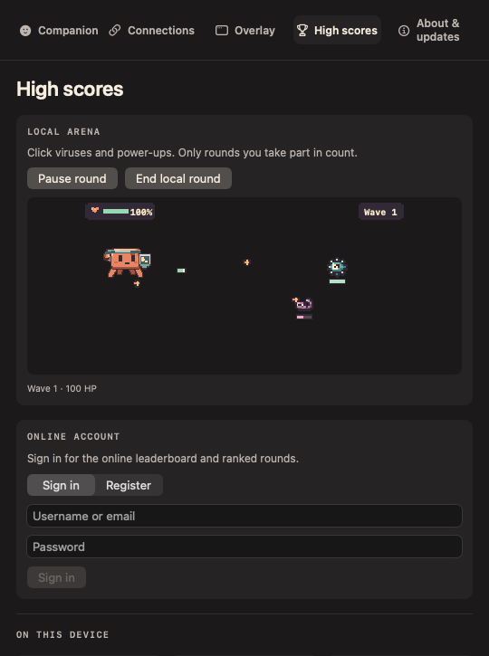

<p align="center"></p>

# Claw’d Companion

[Deutsch](../README.md) · [English](README.en.md) · [简体中文](README.zh-Hans.md) · [हिन्दी](README.hi.md) · [Español](README.es.md) · [العربية](README.ar.md) · **Français** · [বাংলা](README.bn.md) · [Português](README.pt.md) · [Bahasa Indonesia](README.id.md) · [اردو](README.ur.md)

Un petit crabe en pixels sur votre bureau. Claw’d lève les yeux de son portable quand Claude a besoin de vous, suit le pointeur du regard et, entre deux réponses, trouve un rebord de fenêtre où se poser.

[**v0.6.1**](https://github.com/ZUMBYTE-AppSolution/clawd-companion/releases/tag/v0.6.1) · macOS · Windows · Linux · [Zumbyte · AppSolution](https://zumbyte.de/)

## Nouveautés de la version 0.6.1

Sur Mac, Claw’d peut désormais lire le quota restant directement dans la page d’utilisation de Claude Desktop. L’application Claude a sa propre source de quotas, aux côtés de Claude.ai et de Claude Code. Sur Mac, Windows et Linux, choisissez **Meilleurs scores → Commencer une manche locale** pour jouer hors ligne à tout moment.

[Nouveautés de la version 0.6.1](releases/0.6.1/fr.md)

## Aperçu de l’application


| Réglages de la superposition | Connexions |
| --- | --- |
|  |  |

| À propos et mises à jour | Meilleurs scores et comptes d’arène |
| --- | --- |
|  |  |



Le panneau de mise à jour a été photographié sans requête réseau. La capture des meilleurs scores montre le classement natif avec une session de test locale et des scores fictifs.

Les captures montrent l’interface Mac en anglais et des quotas fictifs. La console du navigateur est une reconstitution locale. [↗](media/CAPTURES.md)

## Installation

Sous macOS 13 ou ultérieur, ouvrez le PKG universel ou décompressez l’application et placez-la dans Applications. Sous Windows x64, lancez le programme d’installation ou extrayez le ZIP portable avant d’ouvrir l’exécutable. Sous Linux x86-64, utilisez le DEB, le RPM ou l’archive tar. La page de la version répertorie les fichiers publiés pour chaque système.

La version Mac prend en charge les puces Apple et Intel. Les exemples de fenêtres, d’autorisations et d’intégration avec Claude Code concernent l’application Mac native. Sous Linux, l’intégration dépend aussi du système de fenêtrage.

Windows et Linux utilisent Qt. Sous Windows et X11, Claw’d peut lire la position de la fenêtre active et s’y accrocher. Sous Wayland, l’épinglage aux fenêtres est indisponible. La détection de l’inactivité y utilise GNOME IdleMonitor lorsqu’il est accessible. À défaut de signal, l’arène attend l’autorisation explicite de jouer pendant l’utilisation.

| OS | Installation |
| --- | --- |
| macOS | [PKG](https://github.com/ZUMBYTE-AppSolution/clawd-companion/releases/download/v0.6.1/Clawd-Companion-0.6.1-macOS-universal.pkg) · [ZIP](https://github.com/ZUMBYTE-AppSolution/clawd-companion/releases/download/v0.6.1/Clawd-Companion-0.6.1-macOS-universal.zip) |
| Windows x64 | [Setup](https://github.com/ZUMBYTE-AppSolution/clawd-companion/releases/download/v0.6.1/Clawd-Companion-0.6.1-Windows-x64-Setup.exe) · [Portable ZIP](https://github.com/ZUMBYTE-AppSolution/clawd-companion/releases/download/v0.6.1/Clawd-Companion-0.6.1-Windows-x64-Portable.zip) |
| Linux x86-64 | [DEB](https://github.com/ZUMBYTE-AppSolution/clawd-companion/releases/download/v0.6.1/clawd-companion_0.6.1_amd64.deb) · [RPM](https://github.com/ZUMBYTE-AppSolution/clawd-companion/releases/download/v0.6.1/clawd-companion-0.6.1-1.x86_64.rpm) · [tar.gz](https://github.com/ZUMBYTE-AppSolution/clawd-companion/releases/download/v0.6.1/Clawd-Companion-0.6.1-Linux-x86_64.tar.gz) |

[SHA256SUMS](https://github.com/ZUMBYTE-AppSolution/clawd-companion/releases/download/v0.6.1/SHA256SUMS) · [GitHub Releases](https://github.com/ZUMBYTE-AppSolution/clawd-companion/releases)

**macOS · Homebrew**

```sh
brew tap zumbyte/clawd https://github.com/ZUMBYTE-AppSolution/clawd-companion
brew install --cask zumbyte/clawd/clawd-companion
```

**Debian / Ubuntu**

```sh
sudo apt install ./clawd-companion_0.6.1_amd64.deb
```

**Fedora / RHEL**

```sh
sudo dnf install ./clawd-companion-0.6.1-1.x86_64.rpm
```

## Quand Claude travaille

| Événement visible | Réaction de Claw’d |
| --- | --- |
| Claude rédige ou modifie du texte | Tape sur son petit ordinateur portable. |
| Planification, recherche ou lecture | Dessine un plan sur un chevalet de conférence, examine des sources à la loupe ou ouvre un dossier. |
| Exécution de code ou création d’un artefact | Travaille sur un mini-terminal ou dessine sur un chevalet. |
| Un outil demande votre accord | Déroule une pancarte « OK? » jusqu’au traitement de la demande. Répondez dans Claude. |
| Claude Code signale des sous-agents | Jongle avec des figurines. L’état affiche le nombre réel d’agents. |
| Une réponse se termine ou un avertissement apparaît | Descend en rappel et se réjouit, ou affiche le texte de l’avertissement dans une bulle en pixels. |

## Connecter Claude Desktop (macOS)

1. Dans Claw’d, ouvrez **Connexions** et activez la connexion à **Claude Desktop**.
2. Choisissez **Autoriser l’accès…**. Dans macOS, ouvrez **Réglages Système → Confidentialité et sécurité → Accessibilité** et activez **Claw’d Companion**.
3. Dans **l’application Claude** sur le Mac, ouvrez **Paramètres → Utilisation** et laissez la page ouverte un instant. Choisissez **Lire maintenant** dans Claw’d pour la vérifier de nouveau.

Vous pouvez aussi ouvrir le menu **Utilisation** près du champ de saisie dans Claude. Lorsque ce menu est ouvert, Claw’d peut lire les périodes affichées. Lorsqu’il est fermé, le bouton fournit uniquement la période précisée dans son libellé, par exemple la limite hebdomadaire.

Claw’d relève le pourcentage restant pour la session ou la semaine, ainsi que l’heure de réinitialisation, lorsque Claude affiche ces valeurs dans un format reconnu. Rouvrez la page d’utilisation pour obtenir un relevé récent.

L’activation de la connexion sélectionne **Claude Desktop** comme source de quotas. Le dernier relevé valide conserve son horodatage d’origine. Si vous changez ensuite de source dans **Compagnon → Limites d’utilisation**, Claw’d s’en souvient au prochain démarrage.

[Apple](https://support.apple.com/guide/mac-help/allow-accessibility-apps-to-access-your-mac-mh43185/mac) · [Claude](https://support.claude.com/en/articles/17007452-what-is-a-limit-reset)

## Connecter Claude.ai

Dans Connexions, activez la connexion au navigateur. Dans Chrome, Edge ou Brave, activez le mode développeur, choisissez Charger l’extension non empaquetée et sélectionnez le dossier BrowserExtension fourni. Collez le code d’appairage dans la fenêtre de l’extension et rechargez l’onglet Claude.ai. Sur Mac, l’application inclut aussi une extension Safari. Activez-la et autorisez l’accès à claude.ai.

Ouvrez la page d’utilisation dans le navigateur appairé. Si Claude indique un quota de session ou hebdomadaire, Claw’d peut afficher le pourcentage restant, l’heure de réinitialisation et la dernière mesure. Les délais relatifs sont approximatifs. Les valeurs absentes ou périmées restent vides. La connexion locale transmet les activités et notifications visibles dans les onglets ouverts.

[Claude.ai](https://claude.ai/settings/usage) · [Safari](https://developer.apple.com/documentation/safariservices/running-your-safari-web-extension)

### Essayer une bulle dans la console du navigateur

Dans un onglet Claude.ai appairé, cet exemple ajoute une notification visible et temporaire. L’extension en transmet le texte à Claw’d. La démonstration est locale. La séquence du navigateur illustrée utilise également des événements mis en scène.

```js
(() => {
  const notice = document.createElement("div");
  notice.setAttribute("role", "alert");
  notice.textContent = "Claw’d pixel bubble test";
  Object.assign(notice.style, {
    position: "fixed", top: "1rem", right: "1rem", zIndex: "2147483647",
    background: "#fff", color: "#222", padding: "0.75rem"
  });
  document.body.append(notice);
  setTimeout(() => notice.remove(), 4000);
})();
```


**Claude.ai → Claw’d · JSON**

```jsonl
{"type":"activity","state":"planning"}
{"type":"activity","state":"executing"}
{"type":"activity","state":"done"}
```

## Balades sur les fenêtres, jeux de pointeur et arène des virus

Sur Mac, faites glisser Claw’d sur une fenêtre, faites un clic droit et choisissez Pin to Window. Il garde sa place lorsque la fenêtre bouge et peut en descendre en rappel. En balade, il grimpe sur les barres de titre, observe, cligne des yeux et saute. Son regard suit le pointeur. Le lance-lettres réajuste sa visée à chaque tir d’une rafale aléatoire de 3 à 42 projectiles. Le compteur enregistre le contact avec un projectile visible.

Sur Mac, une manche automatique sur le bureau peut démarrer après au moins 90 secondes sans saisie. Claw’d a 100 points de vie. Deux vagues aléatoires précèdent le boss. Surveillez les barres de vie et ramassez les soins, boucliers ou tirs rapides. Bouger la souris ou taper suspend la partie. Autorisez le jeu pendant l’utilisation pour aider en cliquant. Après une défaite, une pierre tombale marquée GIT reste en place cinq minutes réelles avant que Claw’d sorte de terre. La musique et les effets se règlent séparément.

Dans les réglages de la superposition, choisissez la langue, réduisez les animations et ajustez le volume. Chaque son peut être coupé séparément. Les notifications de Claude.ai gardent leur texte d’origine.

Sur Mac, Windows et Linux, ouvrez **Meilleurs scores → Commencer une manche locale** pour jouer immédiatement. Les manches locales fonctionnent hors ligne, sans compte. Vous pouvez en lancer une à tout moment, sans attendre l’inactivité de l’ordinateur. Vos réglages de jeu automatique sont conservés. Une manche terminée entre dans vos statistiques locales si vous avez touché un ennemi ou ramassé un bonus qui a fait effet. Le classement en ligne compte uniquement les manches jouées sur le serveur après connexion.

## Meilleurs scores et comptes d’arène

Les meilleurs scores regroupent vos points locaux, éliminations, morts, rapport éliminations/morts et victoires. Une manche terminée compte si vous avez touché un ennemi ou ramassé un bonus qui a fait effet. Pour rejoindre le classement en ligne, créez un compte d’arène distinct avec un nom d’utilisateur, un e-mail et un mot de passe, puis connectez-vous dans l’application. Vous lancez vous-même chaque manche classée. Le serveur confirme les actions et calcule le résultat. Le classement affiche votre nom et vos statistiques de jeu. Votre e-mail reste privé. Le serveur doit être joignable pour jouer en ligne.

## Galerie d’animations

| Expressions et jeux | Déplacements sur les fenêtres |
| --- | --- |
|  |  |

| Outils et autorisations Claude | Combat, tombe et résurrection |
| --- | --- |
|  |  |


▶ [Voir l’arène avec le son. Le film raccourcit l’attente de cinq minutes devant la tombe.](media/virus-arena.mp4)

## Mises à jour et développement local

L’application consulte les versions sur GitHub au démarrage puis chaque jour. Lorsqu’une mise à jour est disponible, la notification mène à ses nouveautés et au téléchargement pour votre système.

Dans À propos et mises à jour, recherchez une version et choisissez un paquet. Installez-le comme indiqué plus haut. Sur Mac, Connexions permet d’activer séparément les événements de Claude Code et la lecture des quotas. Ouvrez ensuite une nouvelle session Claude Code. Le navigateur et le terminal conservent leurs propres mesures.

L’application Mac utilise Swift et AppKit. Installez Xcode puis compilez depuis la racine du dépôt. Les tests JavaScript utilisent des données locales. Le client de bureau portable se trouve dans Desktop.

```sh
./Scripts/build-mac.sh
swift test
node --test BrowserTests/*.test.js
python3 Scripts/test-hooks.py
```

[Swift](../Package.swift) · [Desktop](../Desktop/) · [Claude Code](https://code.claude.com/docs/en/hooks) · [Status line](https://code.claude.com/docs/en/statusline)

[Windows](../Scripts/package-windows.ps1) · [Linux](../Scripts/package-linux.sh)

## Studio et communauté

Andreas Zumbansen dirige Zumbyte · AppSolution à Kamen, en Allemagne. Ce studio indépendant conçoit des applications mobiles et de bureau, ainsi que des logiciels sur mesure pour les entreprises et les équipes.

Zumbyte · AppSolution · Kastanienallee 16a · 59174 Kamen · DE · +49 177 4149667

[Zumbyte](https://zumbyte.de/) · [Mentions légales](https://zumbyte.de/impressum/) · [info@zumbyte.de](mailto:info@zumbyte.de)

Un grand bonjour à toute la communauté qui code avec l’IA. Merci de créer, de partager et de vous entraider !
