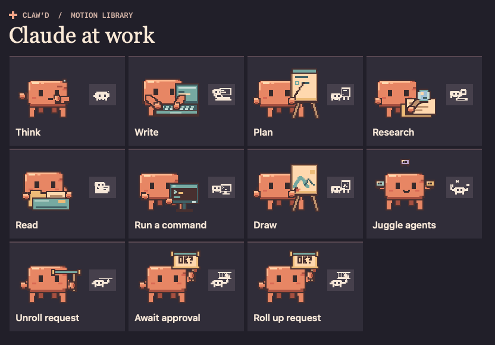

<p align="center"></p>

# Claw’d Companion

[Deutsch](../README.md) · [English](README.en.md) · [简体中文](README.zh-Hans.md) · **हिन्दी** · [Español](README.es.md) · [العربية](README.ar.md) · [Français](README.fr.md) · [বাংলা](README.bn.md) · [Português](README.pt.md) · [Bahasa Indonesia](README.id.md) · [اردو](README.ur.md)

आपके डेस्कटॉप पर रहने वाला एक नन्हा पिक्सेल केकड़ा। जब Claude को आपकी ज़रूरत होती है, Claw’d अपने लैपटॉप से नज़र उठाता है। बाकी समय वह कर्सर को देखता है या किसी विंडो के किनारे पैर लटकाकर बैठ जाता है।

[**v0.7.1**](https://github.com/ZUMBYTE-AppSolution/clawd-companion/releases/tag/v0.7.1) · macOS · Windows · Linux · [Zumbyte · AppSolution](https://zumbyte.de/)

## अंतहीन अखाड़ा · 0.7.1

**ओवरले → दिखावट** में हल्का, गहरा या सिस्टम के अनुसार चुनें। बदलाव तुरंत लागू होता है और पुनः शुरू करने पर बना रहता है। Linux पर Wayland विंडो, टैब, मेनू और इनपुट फ़ील्ड में एक जैसी रंग योजना दिखती है।

हाई स्कोर से अखाड़ा अधिकतम आकार में खोलें। WASD या तीर वाली कुंजियों से चलें। Claw’d अपने आप गोली चलाता है। हर स्तर में चार लहरें और एक बॉस है।

शुरू में तीन जीवन मिलते हैं। हर दो स्तर पूरे करने पर एक और जीवन मिलता है। भेदी गोली, एक साथ कई गोलियाँ और क्षेत्रीय क्षति को मिलाएँ। आपका सर्वश्रेष्ठ स्तर और लहर इसी उपकरण पर सहेजे जाते हैं।

<p> </p>

## ऐप की एक झलक


| ओवरले सेटिंग | कनेक्शन |
| --- | --- |
|  |  |

| परिचय और अपडेट | हाई स्कोर और अखाड़े का खाता |
| --- | --- |
|  |  |


अपडेट पैनल की तस्वीर बिना नेटवर्क अनुरोध के ली गई है। हाई स्कोर की तस्वीर में मूल रैंकिंग इंटरफ़ेस, स्थानीय टेस्ट सत्र और उदाहरण के स्कोर हैं।

स्क्रीनशॉट Mac का अंग्रेज़ी इंटरफ़ेस दिखाते हैं। कोटे के आँकड़े उदाहरण हैं और ब्राउज़र कंसोल का दृश्य स्थानीय रीप्ले है। [↗](media/CAPTURES.md)

## इंस्टॉल करें

macOS 13 या बाद के संस्करण पर यूनिवर्सल PKG खोलें या ऐप को अनज़िप करके Applications में रखें। Windows x64 पर सेटअप चलाएँ या पोर्टेबल ZIP निकालकर उसमें मौजूद EXE खोलें। Linux x86-64 पर DEB, RPM या tar आर्काइव चुनें। हर प्लेटफ़ॉर्म के लिए अपलोड की गई फ़ाइलें रिलीज़ पेज पर मिलेंगी।

Mac ऐप Apple Silicon और Intel दोनों पर चलता है। नीचे दिए गए विंडो, अनुमतियों और Claude Code के उदाहरण मूल Mac ऐप के हैं। Linux पर डेस्कटॉप सुविधाएँ विंडो सिस्टम पर भी निर्भर करती हैं।

Windows और Linux में Qt इस्तेमाल होता है। Windows और X11 पर Claw’d सक्रिय विंडो की स्थिति और आकार पढ़कर उससे चिपक सकता है। Wayland में विंडो पिन उपलब्ध नहीं है। वहाँ खाली समय की पहचान के लिए उपलब्ध होने पर GNOME IdleMonitor इस्तेमाल होता है। संकेत न मिले तो अखाड़ा तभी चलता है जब इस्तेमाल के दौरान खेलने की अनुमति दी गई हो।

| OS | इंस्टॉल करें |
| --- | --- |
| macOS | [PKG](https://github.com/ZUMBYTE-AppSolution/clawd-companion/releases/download/v0.7.1/Clawd-Companion-0.7.1-macOS-universal.pkg) · [ZIP](https://github.com/ZUMBYTE-AppSolution/clawd-companion/releases/download/v0.7.1/Clawd-Companion-0.7.1-macOS-universal.zip) |
| Windows x64 | [Setup](https://github.com/ZUMBYTE-AppSolution/clawd-companion/releases/download/v0.7.1/Clawd-Companion-0.7.1-Windows-x64-Setup.exe) · [Portable ZIP](https://github.com/ZUMBYTE-AppSolution/clawd-companion/releases/download/v0.7.1/Clawd-Companion-0.7.1-Windows-x64-Portable.zip) |
| Linux x86-64 | [DEB](https://github.com/ZUMBYTE-AppSolution/clawd-companion/releases/download/v0.7.1/clawd-companion_0.7.1_amd64.deb) · [RPM](https://github.com/ZUMBYTE-AppSolution/clawd-companion/releases/download/v0.7.1/clawd-companion-0.7.1-1.x86_64.rpm) · [tar.gz](https://github.com/ZUMBYTE-AppSolution/clawd-companion/releases/download/v0.7.1/Clawd-Companion-0.7.1-Linux-x86_64.tar.gz) |

[SHA256SUMS](https://github.com/ZUMBYTE-AppSolution/clawd-companion/releases/download/v0.7.1/SHA256SUMS) · [GitHub Releases](https://github.com/ZUMBYTE-AppSolution/clawd-companion/releases)

**macOS · Homebrew**

```sh
brew tap zumbyte/clawd https://github.com/ZUMBYTE-AppSolution/clawd-companion
brew install --cask zumbyte/clawd/clawd-companion
```

**Debian / Ubuntu**

```sh
sudo apt install ./clawd-companion_0.7.1_amd64.deb
```

**Fedora / RHEL**

```sh
sudo dnf install ./clawd-companion-0.7.1-1.x86_64.rpm
```

## जब Claude काम करता है

| स्क्रीन पर क्या दिखता है | Claw’d क्या करता है |
| --- | --- |
| Claude लिखता या बदलाव करता है | अपने छोटे से लैपटॉप पर टाइप करता है। |
| योजना, खोज या पढ़ना | फ्लिपचार्ट पर योजना बनाता है, लेंस से स्रोत देखता है या फ़ोल्डर खोलता है। |
| कोड चलाना या आर्टिफ़ैक्ट बनाना | छोटे टर्मिनल पर काम करता है या चित्रफलक पर बनाता है। |
| कोई टूल अनुमति माँगता है | फ़ैसला होने तक “OK?” की तख्ती थामे रहता है। अपना जवाब Claude में दें। |
| Claude Code सब-एजेंट की सूचना देता है | एजेंट के पुतलों से जगलिंग करता है। उनकी सही संख्या स्थिति में दिखती है। |
| जवाब पूरा होता है या चेतावनी आती है | रस्सी से उतरकर खुशी मनाता है या चेतावनी का पाठ पिक्सेल बुलबुले में दिखाता है। |

## Claude Desktop से जुड़ें (macOS)

1. Claw’d में **कनेक्शन** खोलें और **Claude Desktop** कनेक्शन चालू करें।
2. **पहुँच की अनुमति दें…** चुनें। macOS की **सिस्टम सेटिंग → गोपनीयता और सुरक्षा → सुलभता** में **Claw’d Companion** चालू करें।
3. अपने Mac पर **Claude ऐप** में **सेटिंग → उपयोग** खोलें और पेज को कुछ देर खुला रखें। दोबारा जाँचने के लिए Claw’d में **अभी पढ़ें** चुनें।

Claude में संदेश लिखने के खाने के पास **उपयोग** मेन्यू भी खोल सकते हैं। मेन्यू खुला हो तो Claw’d उसमें दिख रही अवधियों की सीमाएँ पढ़ सकता है। बंद होने पर बटन से सिर्फ़ उसके लेबल पर लिखी अवधि की जानकारी मिलती है, जैसे साप्ताहिक सीमा।

जब Claude सत्र या सप्ताह की सीमा और रीसेट का समय समर्थित रूप में दिखाता है, तब Claw’d बचा हुआ प्रतिशत और उपलब्ध रीसेट समय पढ़ लेता है। नई रीडिंग के लिए उपयोग पेज फिर खोलें।

कनेक्शन चालू करते ही **Claude Desktop** कोटे का स्रोत बन जाता है। पिछली मान्य रीडिंग के साथ उसका मूल समय रहता है। बाद में **साथी → उपयोग सीमाएँ** में कोई दूसरा स्रोत चुनें तो अगली बार भी वही चयन रहेगा।

[Apple](https://support.apple.com/guide/mac-help/allow-accessibility-apps-to-access-your-mac-mh43185/mac) · [Claude](https://support.claude.com/en/articles/17007452-what-is-a-limit-reset)

## Claude.ai से जुड़ें

कनेक्शन में ब्राउज़र कनेक्शन चालू करें। Chrome, Edge या Brave में डेवलपर मोड चालू करके Load unpacked चुनें और साथ आया BrowserExtension फ़ोल्डर खोलें। ऐप का पेयरिंग कोड एक्सटेंशन के पॉपअप में डालें और Claude.ai टैब रीलोड करें। Mac पर Safari का एक्सटेंशन भी शामिल है। उसे चालू करके claude.ai की अनुमति दें।

जुड़े हुए ब्राउज़र में उपयोग वाला पेज खोलें। यदि Claude सत्र या सप्ताह की सीमा दिखाता है तो Claw’d बचा प्रतिशत, रीसेट का समय और पिछली रीडिंग दिखा सकता है। सापेक्ष समय अनुमानित होता है। अनुपलब्ध या पुराना मान खाली रहता है। एक्सटेंशन खुले टैब पर दिख रही गतिविधि और सूचनाएँ स्थानीय कनेक्शन से भेजता है।

[Claude.ai](https://claude.ai/settings/usage) · [Safari](https://developer.apple.com/documentation/safariservices/running-your-safari-web-extension)

### ब्राउज़र कंसोल से बोलता बुलबुला आज़माएँ

जुड़े Claude.ai टैब में यह उदाहरण थोड़ी देर के लिए एक सूचना दिखाता है। एक्सटेंशन उसका पाठ Claw’d तक पहुँचाता है। यह स्थानीय डेमो है। चित्रों में दिखाए ब्राउज़र क्रम में भी उदाहरण के लिए बनाए गए इवेंट हैं।

```js
(() => {
  const notice = document.createElement("div");
  notice.setAttribute("role", "alert");
  notice.textContent = "Claw’d pixel bubble test";
  Object.assign(notice.style, {
    position: "fixed", top: "1rem", right: "1rem", zIndex: "2147483647",
    background: "#fff", color: "#222", padding: "0.75rem"
  });
  document.body.append(notice);
  setTimeout(() => notice.remove(), 4000);
})();
```


**Claude.ai → Claw’d · JSON**

```jsonl
{"type":"activity","state":"planning"}
{"type":"activity","state":"executing"}
{"type":"activity","state":"done"}
```

## विंडो पर सैर, कर्सर के खेल और वायरस अखाड़ा

Mac पर Claw’d को खींचकर किसी विंडो पर रखें, राइट-क्लिक करें और Pin to Window चुनें। विंडो खिसकाने पर भी वह उसी जगह टिका रहता है और वहाँ से रस्सी पर उतर सकता है। सैर करते हुए वह टाइटल बार पर चढ़ता है, इधर-उधर देखता है, पलकें झपकाता है और नीचे कूदता है। उसकी आँखें कर्सर का पीछा करती हैं। अक्षर वाला ब्लास्टर हर बारी 3 से 42 शॉट चलाता है और हर बार फिर से निशाना लगाता है। दिखता हुआ अक्षर पॉइंटर से टकराए तभी हिट गिनी जाती है।

Mac पर डेस्कटॉप का स्वचालित राउंड कम से कम 90 सेकंड तक कोई इनपुट न मिलने पर शुरू हो सकता है। Claw’d की सेहत 100 है। दुश्मनों की दो बेतरतीब लहरों के बाद बॉस आता है। उनकी सेहत की पट्टियाँ देखें और इलाज, ढाल या तेज़ फ़ायर बटोरें। इनपुट देने पर खेल रुक जाता है। इस्तेमाल के दौरान खेलने की अनुमति देकर क्लिक से मदद की जा सकती है। हारने पर पाँच वास्तविक मिनट तक GIT लिखा पत्थर रहता है, फिर Claw’d मिट्टी से बाहर निकलता है। संगीत और ध्वनि प्रभाव अलग-अलग बंद कर सकते हैं।

ओवरले सेटिंग में भाषा, कम गति और आवाज़ चुनें। हर ध्वनि अलग से बंद की जा सकती है। Claude.ai की सूचनाएँ मूल भाषा में रहती हैं।

## हाई स्कोर और अखाड़े का खाता

हाई स्कोर में इसी डिवाइस के अंक, हराए दुश्मन, मौतें, किल/डेथ अनुपात और जीत दिखती हैं। पूरा राउंड तभी गिना जाता है जब आपने ख़ुद किसी दुश्मन को निशाना बनाया हो या असर करने वाला पावर-अप लिया हो। ऑनलाइन रैंकिंग के लिए नाम, ईमेल और पासवर्ड से अलग अखाड़ा खाता बनाएँ और ऐप में साइन इन करें। रैंक वाला राउंड आप ख़ुद शुरू करते हैं। सर्वर गतिविधि की पुष्टि करके परिणाम निकालता है। सूची में आपका नाम और खेल के आँकड़े दिखते हैं। ईमेल निजी रहता है। ऑनलाइन खेलने के लिए गेम सर्वर से कनेक्शन चाहिए।

## ऐनिमेशन गैलरी

| हावभाव और खेल | विंडो पर हलचल |
| --- | --- |
|  |  |

| Claude टूल और अनुमतियाँ | लड़ाई, कब्र और वापसी |
| --- | --- |
|  |  |


▶ [आवाज़ के साथ अखाड़ा देखें। वीडियो में कब्र पर पाँच मिनट का इंतज़ार छोटा किया गया है।](media/virus-arena.mp4)

## अपडेट और स्थानीय विकास

ऐप शुरू होते समय और फिर रोज़ GitHub पर रिलीज़ जाँचता है। नया संस्करण मिलने पर सूचना के ज़रिए बदलाव और अपने सिस्टम का डाउनलोड खोलें।

परिचय और अपडेट में नई रिलीज़ देखकर उसका पैकेज चुनें। डाउनलोड के बाद ऊपर दिए तरीके से उसे इंस्टॉल करें। Mac ऐप के कनेक्शन में Claude Code की गतिविधि और कोटा अलग-अलग चालू कर सकते हैं। सेटअप के बाद नया Claude Code सत्र खोलें। ब्राउज़र और टर्मिनल की रीडिंग अलग रहती हैं।

Mac ऐप Swift और AppKit में बना है। Xcode इंस्टॉल करके रिपॉज़िटरी की मुख्य डायरेक्टरी से बिल्ड करें। JavaScript परीक्षण स्थानीय ब्राउज़र डेटा इस्तेमाल करते हैं। पोर्टेबल डेस्कटॉप क्लाइंट Desktop में है।

```sh
./Scripts/build-mac.sh
swift test
node --test BrowserTests/*.test.js
python3 Scripts/test-hooks.py
```

[Swift](../Package.swift) · [Desktop](../Desktop/) · [Claude Code](https://code.claude.com/docs/en/hooks) · [Status line](https://code.claude.com/docs/en/statusline)

[Windows](../Scripts/package-windows.ps1) · [Linux](../Scripts/package-linux.sh)

## स्टूडियो और समुदाय

Andreas Zumbansen जर्मनी के कामेन में Zumbyte · AppSolution चलाते हैं। यह स्वतंत्र स्टूडियो मोबाइल और डेस्कटॉप ऐप बनाता है और कंपनियों व टीमों की ज़रूरत के मुताबिक सॉफ़्टवेयर विकसित करता है।

Zumbyte · AppSolution · Kastanienallee 16a · 59174 Kamen · DE · +49 177 4149667

[Zumbyte](https://zumbyte.de/) · [कानूनी जानकारी](https://zumbyte.de/impressum/) · [info@zumbyte.de](mailto:info@zumbyte.de)

एआई के साथ कोड लिखने वाले सभी साथियों को ढेरों शुभकामनाएँ। नई चीज़ें बनाने, साझा करने और एक-दूसरे की मदद करने के लिए शुक्रिया!
