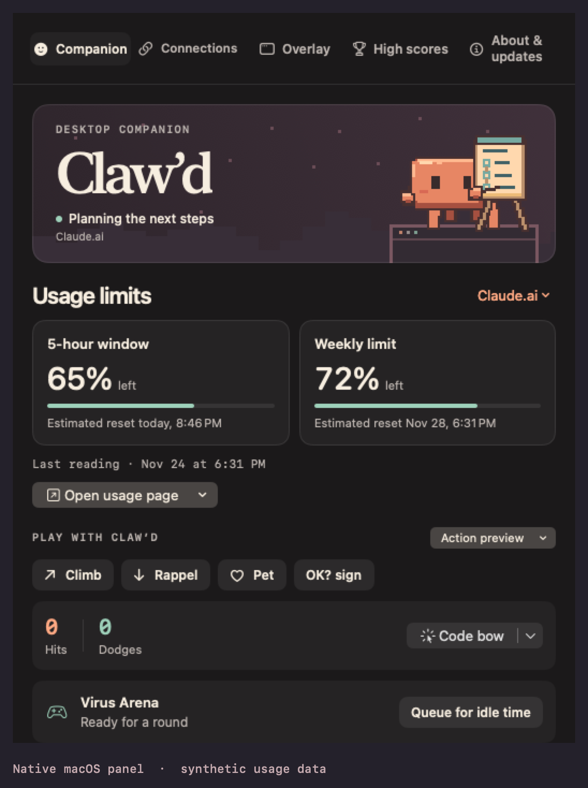
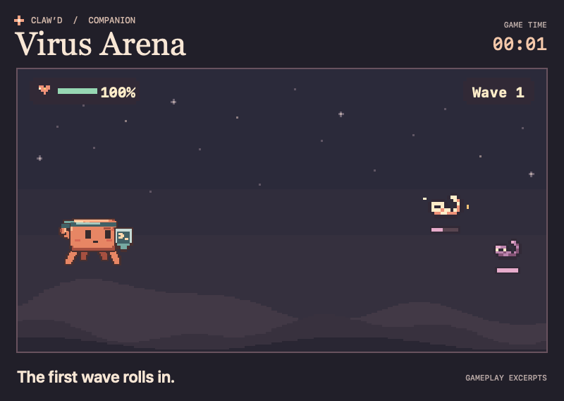

<p align="center"></p>

# Claw’d Companion

[Deutsch](../README.md) · [English](README.en.md) · [简体中文](README.zh-Hans.md) · [हिन्दी](README.hi.md) · [Español](README.es.md) · [العربية](README.ar.md) · [Français](README.fr.md) · [বাংলা](README.bn.md) · [Português](README.pt.md) · **Bahasa Indonesia** · [اردو](README.ur.md)

Seekor kepiting piksel kecil untuk desktop Anda. Claw’d mengangkat kepala dari laptop saat Claude membutuhkan perhatian, mengikuti kursor dengan matanya, lalu beristirahat di tepi jendela di sela-sela balasan.

[**v0.6.0**](https://github.com/ZUMBYTE-AppSolution/clawd-companion/releases/tag/v0.6.0) · macOS · Windows · Linux · [Zumbyte · AppSolution](https://zumbyte.de/)

## Yang baru di versi 0.6.0

Selain aplikasi Mac, kini ada paket desktop untuk Windows dan Linux. Lewat Tentang dan pembaruan, Anda dapat memeriksa rilis, membaca perubahannya, lalu memilih paket.

[Yang baru di versi 0.6.0](releases/0.6.0/id.md)

## Tampilan aplikasi



| Pengaturan overlay | Koneksi |
| --- | --- |
|  |  |

| Tentang dan pembaruan | Skor tertinggi dan akun arena |
| --- | --- |
|  |  |

Panel pembaruan direkam tanpa mengirim permintaan jaringan. Gambar skor tertinggi menunjukkan papan peringkat native dengan sesi uji lokal dan skor contoh.

Tangkapan layar menunjukkan antarmuka Mac berbahasa Inggris dengan contoh data kuota. Konsol browser merupakan peragaan lokal. [↗](media/CAPTURES.md)

## Instalasi

Di macOS 13 atau lebih baru, buka PKG universal atau ekstrak aplikasinya dan pindahkan ke Applications. Di Windows x64, jalankan program pemasangan atau ekstrak ZIP portabel sebelum membuka berkas EXE. Untuk Linux x86-64, pilih DEB, RPM, atau arsip tar. Halaman rilis mencantumkan berkas yang telah diunggah untuk tiap platform.

Aplikasi Mac mendukung Apple Silicon dan Intel. Contoh jendela, izin, dan integrasi Claude Code di bawah ini mengacu pada aplikasi native Mac. Di Linux, integrasi desktop juga bergantung pada sistem jendela.

Windows dan Linux menggunakan Qt. Pada Windows dan X11, Claw’d dapat membaca posisi jendela aktif dan menempel padanya. Penyematan jendela tidak tersedia di Wayland. Di sana, permainan otomatis saat menganggur menggunakan GNOME IdleMonitor jika tersedia. Tanpa sinyal tidak aktif, arena menunggu izin eksplisit untuk bermain saat komputer digunakan.

| OS | Instalasi |
| --- | --- |
| macOS | [PKG](https://github.com/ZUMBYTE-AppSolution/clawd-companion/releases/download/v0.6.0/Clawd-Companion-0.6.0-macOS-universal.pkg) · [ZIP](https://github.com/ZUMBYTE-AppSolution/clawd-companion/releases/download/v0.6.0/Clawd-Companion-0.6.0-macOS-universal.zip) |
| Windows x64 | [Setup](https://github.com/ZUMBYTE-AppSolution/clawd-companion/releases/download/v0.6.0/Clawd-Companion-0.6.0-Windows-x64-Setup.exe) · [Portable ZIP](https://github.com/ZUMBYTE-AppSolution/clawd-companion/releases/download/v0.6.0/Clawd-Companion-0.6.0-Windows-x64-Portable.zip) |
| Linux x86-64 | [DEB](https://github.com/ZUMBYTE-AppSolution/clawd-companion/releases/download/v0.6.0/clawd-companion_0.6.0_amd64.deb) · [RPM](https://github.com/ZUMBYTE-AppSolution/clawd-companion/releases/download/v0.6.0/clawd-companion-0.6.0-1.x86_64.rpm) · [tar.gz](https://github.com/ZUMBYTE-AppSolution/clawd-companion/releases/download/v0.6.0/Clawd-Companion-0.6.0-Linux-x86_64.tar.gz) |

[SHA256SUMS](https://github.com/ZUMBYTE-AppSolution/clawd-companion/releases/download/v0.6.0/SHA256SUMS) · [GitHub Releases](https://github.com/ZUMBYTE-AppSolution/clawd-companion/releases)

**macOS · Homebrew**

```sh
brew tap zumbyte/clawd https://github.com/ZUMBYTE-AppSolution/clawd-companion
brew install --cask zumbyte/clawd/clawd-companion
```

**Debian / Ubuntu**

```sh
sudo apt install ./clawd-companion_0.6.0_amd64.deb
```

**Fedora / RHEL**

```sh
sudo dnf install ./clawd-companion-0.6.0-1.x86_64.rpm
```

## Saat Claude bekerja

| Peristiwa yang terlihat | Reaksi Claw’d |
| --- | --- |
| Claude menulis atau menyunting | Mengetik di laptop mungilnya. |
| Membuat rencana, menelusuri, atau membaca | Menggambar rencana di papan, memeriksa sumber dengan kaca pembesar, atau membuka map. |
| Menjalankan kode atau membuat artefak | Bekerja di terminal kecil atau menggambar di atas penyangga lukis. |
| Sebuah alat meminta izin | Membentangkan papan “OK?” sampai permintaan ditangani. Berikan jawaban di Claude. |
| Claude Code melaporkan subagen | Berjuggling dengan boneka agen. Jumlah sebenarnya tercantum pada status. |
| Balasan selesai atau muncul peringatan | Turun dengan tali lalu bergembira, atau menampilkan peringatan dalam balon percakapan piksel. |

## Hubungkan Claude.ai

Aktifkan koneksi browser pada menu Koneksi. Di Chrome, Edge, atau Brave, aktifkan mode developer, pilih Load unpacked, lalu pilih folder BrowserExtension yang disertakan. Tempel kode penyandingan dari aplikasi ke pop-up ekstensi dan muat ulang tab Claude.ai. Aplikasi Mac juga menyertakan ekstensi Safari. Aktifkan dan izinkan akses ke claude.ai.

Buka halaman penggunaan di browser yang sudah disandingkan. Jika Claude menampilkan kuota sesi atau mingguan, Claw’d dapat menampilkan persentase tersisa, waktu reset, dan waktu pembacaan terakhir. Waktu relatif merupakan perkiraan. Nilai yang tidak tersedia atau sudah kedaluwarsa dibiarkan kosong. Aktivitas dan pemberitahuan yang terlihat pada tab terbuka diteruskan melalui koneksi lokal.

[Claude.ai](https://claude.ai/settings/usage) · [Safari](https://developer.apple.com/documentation/safariservices/running-your-safari-web-extension)

### Coba balon percakapan di konsol browser

Di tab Claude.ai yang tersanding, contoh berikut menambahkan pemberitahuan sementara pada halaman. Ekstensi meneruskan teksnya ke Claw’d. Demo berjalan secara lokal. Rangkaian gambar browser juga menggunakan peristiwa yang diperagakan.

```js
(() => {
  const notice = document.createElement("div");
  notice.setAttribute("role", "alert");
  notice.textContent = "Claw’d pixel bubble test";
  Object.assign(notice.style, {
    position: "fixed", top: "1rem", right: "1rem", zIndex: "2147483647",
    background: "#fff", color: "#222", padding: "0.75rem"
  });
  document.body.append(notice);
  setTimeout(() => notice.remove(), 4000);
})();
```


**Claude.ai → Claw’d · JSON**

```jsonl
{"type":"activity","state":"planning"}
{"type":"activity","state":"executing"}
{"type":"activity","state":"done"}
```

## Jalan-jalan di jendela, permainan kursor, dan arena virus

Di Mac, seret Claw’d ke jendela, klik kanan, dan pilih Pin to Window. Saat jendela bergeser, ia tetap di titik yang sama dan dapat turun dengan tali. Saat berkeliaran, ia memanjat bilah judul, menengok, berkedip, lalu melompat turun. Matanya mengikuti penunjuk. Pelontar huruf membidik ulang pada setiap tembakan dalam rentetan acak berisi 3 sampai 42 huruf. Hitungan bertambah saat proyektil yang terlihat menyentuh penunjuk.

Di Mac, arena dapat dimulai setelah setidaknya 90 detik tanpa masukan. Claw’d memiliki 100 poin kesehatan. Dua gelombang acak diikuti bos terakhir. Amati bilah kesehatan musuh dan kumpulkan pemulihan, perisai, atau tembakan cepat. Masukan pengguna menjeda permainan. Izinkan bermain saat komputer digunakan agar Anda bisa membantu dengan mengeklik. Setelah kalah, nisan bertuliskan GIT akan berdiri selama lima menit waktu nyata sebelum ia menggali jalan ke permukaan. Musik dan tiap efek suara dapat diatur terpisah.

Atur bahasa, pengurangan gerakan, dan volume di pengaturan overlay. Tiap bunyi bisa dibisukan terpisah. Pemberitahuan Claude.ai mempertahankan teks aslinya.

## Skor tertinggi dan akun arena

Skor tertinggi menampilkan poin lokal, musuh yang dikalahkan, kematian, rasio K/D, dan kemenangan. Ronde yang selesai dihitung bila Anda mengenai musuh atau mengambil power-up yang berefek. Untuk bergabung di papan peringkat daring, buat akun khusus arena dengan nama pengguna, email, dan kata sandi, lalu masuk di aplikasi. Anda sendiri yang memulai ronde berperingkat. Server mengonfirmasi tindakan dan menghitung hasil. Papan peringkat menampilkan nama pengguna dan statistik permainan. Email Anda tetap pribadi. Permainan daring memerlukan koneksi ke server game.

## Galeri animasi

| Ekspresi dan permainan | Gerakan di jendela |
| --- | --- |
|  |  |

| Alat dan izin Claude | Pertarungan, makam, dan bangkit kembali |
| --- | --- |
|  |  |



▶ [Tonton arena dengan suara. Video menyingkat lima menit penantian di makam.](media/virus-arena.mp4)

## Pembaruan dan pengembangan lokal

Aplikasi memeriksa informasi rilis GitHub saat dimulai dan setiap hari sesudahnya. Pemberitahuan versi baru mengarah ke catatan perubahan dan unduhan untuk sistem Anda.

Di Tentang dan pembaruan, cari versi baru dan pilih paketnya. Instal paket yang telah diunduh dengan cara di atas. Di Mac, menu Koneksi dapat mengaktifkan aktivitas Claude Code dan pembacaan kuota secara terpisah. Mulai sesi Claude Code yang baru setelah pengaturan. Browser dan terminal menyimpan hasil pembacaan masing-masing.

Aplikasi Mac menggunakan Swift dan AppKit. Instal Xcode, lalu bangun aplikasi dari direktori akar repositori. Pengujian JavaScript menggunakan data browser lokal. Klien desktop portabel ada di folder Desktop.

```sh
./Scripts/build-mac.sh
swift test
node --test BrowserTests/*.test.js
python3 Scripts/test-hooks.py
```

[Swift](../Package.swift) · [Desktop](../Desktop/) · [Claude Code](https://code.claude.com/docs/en/hooks) · [Status line](https://code.claude.com/docs/en/statusline)

[Arena API](../Server/README.md) · [Windows](../Scripts/package-windows.ps1) · [Linux](../Scripts/package-linux.sh)

## Studio dan komunitas

Andreas Zumbansen mengelola Zumbyte · AppSolution di Kamen, Jerman. Studio independen ini membuat aplikasi seluler dan desktop serta perangkat lunak khusus untuk perusahaan dan tim.

Zumbyte · AppSolution · Kastanienallee 16a · 59174 Kamen · DE · +49 177 4149667

[Zumbyte](https://zumbyte.de/) · [Informasi hukum](https://zumbyte.de/impressum/) · [info@zumbyte.de](mailto:info@zumbyte.de)

Salam hangat untuk seluruh komunitas pemrograman dengan AI. Terima kasih sudah berkarya, berbagi, dan saling membantu!
