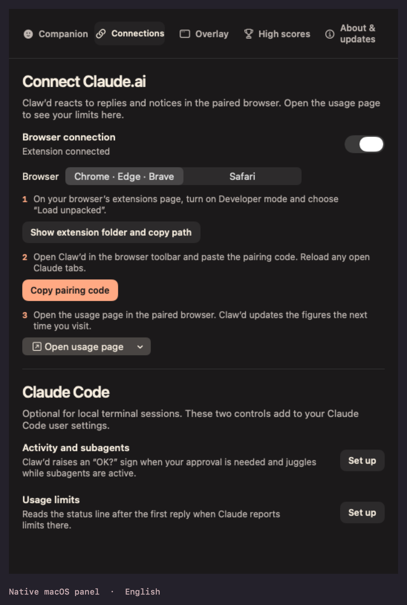
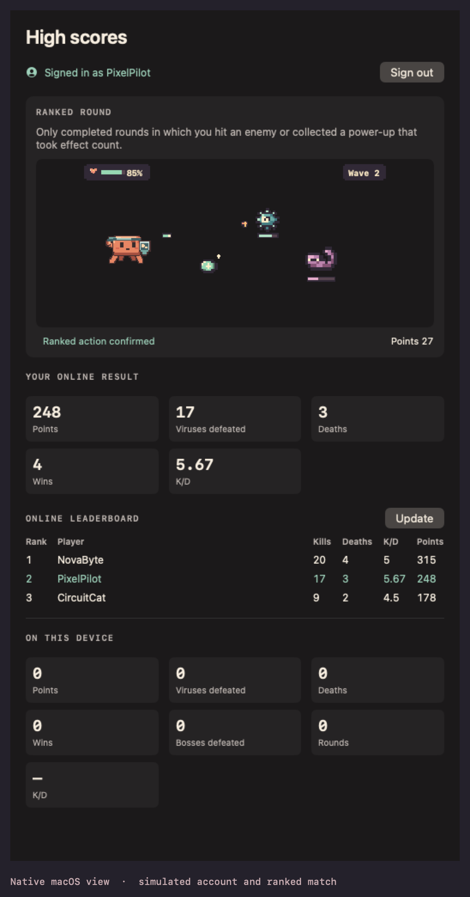

<p align="center"></p>

# Claw’d Companion

[Deutsch](../README.md) · [English](README.en.md) · [简体中文](README.zh-Hans.md) · [हिन्दी](README.hi.md) · [Español](README.es.md) · [العربية](README.ar.md) · [Français](README.fr.md) · [বাংলা](README.bn.md) · [Português](README.pt.md) · [Bahasa Indonesia](README.id.md) · **اردو**

آپ کے ڈیسک ٹاپ کا ننھا سا پِکسل کیکڑا۔ جب Claude کو آپ کی توجہ چاہیے تو Claw’d اپنے لیپ ٹاپ سے سر اٹھاتا ہے۔ باقی وقت وہ کرسر کو تکتا ہے یا کسی ونڈو کے کنارے پر بیٹھ کر سستاتا ہے۔

[**تازہ ترین ریلیز**](https://github.com/ZUMBYTE-AppSolution/clawd-companion/releases/latest) · macOS · Windows · Linux · [Zumbyte · AppSolution](https://zumbyte.de/)

## لامحدود میدان

**0.7.2 · main** — فرصت میں Claw’d خالی ٹائٹل بار پر 45 سے 100 سیکنڈ تک بیٹھنا پسند کرتا ہے۔ ونڈو کھسکانے پر وہ ساتھ حرکت کرتا ہے۔ Wayland پر اس کی اپنی ونڈو میں پکسل کنارہ ہے۔

**اوورلے ← ظاہری شکل** میں روشن، تاریک یا سسٹم کے مطابق منتخب کریں۔ تبدیلی فوراً لاگو ہوتی ہے اور دوبارہ شروع کرنے پر برقرار رہتی ہے۔ لینکس پر Wayland ونڈو، ٹیب، مینو اور اندراج کے خانوں میں ہم آہنگ رنگ دکھائی دیتے ہیں۔

اعلیٰ اسکور سے میدان کو پوری ونڈو میں کھولیں۔ WASD یا تیر والے بٹنوں سے حرکت کریں۔ Claw’d خود فائر کرتا ہے۔ ہر سطح میں چار لہریں اور ایک باس ہوتا ہے۔

تین جانوں سے آغاز کریں۔ ہر دو سطحیں مکمل کرنے پر ایک اضافی جان ملتی ہے۔ آر پار گولی، متعدد فائر اور دھماکے کو ملائیں۔ بہترین سطح اور لہر اسی آلے پر محفوظ رہتی ہیں۔

<p> </p>

## ایپ کی ایک جھلک


| اوورلے کی ترتیبات | کنکشن |
| --- | --- |
|  |  |

| تعارف اور اپ ڈیٹس | اعلیٰ اسکور اور میدان کا اکاؤنٹ |
| --- | --- |
|  |  |


اپ ڈیٹ پینل کی تصویر لیتے وقت نیٹ ورک کو کوئی درخواست نہیں بھیجی گئی۔ اعلیٰ اسکور کی تصویر میں مقامی رینکنگ انٹرفیس، ایک ٹیسٹ سیشن اور نمونہ اسکور دکھائے گئے ہیں۔

تصاویر میں Mac کا انگریزی انٹرفیس اور کوٹے کے نمونہ اعداد ہیں۔ براؤزر کنسول مقامی طور پر دکھایا گیا منظر ہے۔ [↗](media/CAPTURES.md)

## انسٹال کریں

macOS 13 یا بعد کے ورژن میں یونیورسل PKG کھولیں یا ایپ کو ان زپ کرکے Applications میں رکھیں۔ Windows x64 پر سیٹ اپ چلائیں یا پورٹیبل ZIP کھول کر اندر موجود EXE چلائیں۔ Linux x86-64 کے لیے DEB، RPM یا tar آرکائیو استعمال کریں۔ ہر پلیٹ فارم کے لیے جاری کردہ فائلیں ریلیز کے صفحے پر ملیں گی۔

Mac ایپ Apple Silicon اور Intel دونوں پر چلتی ہے۔ نیچے ونڈوز، اجازتوں اور Claude Code کے اتصال کی مثالیں مقامی Mac ایپ کی ہیں۔ Linux پر ڈیسک ٹاپ کی سہولتیں ونڈو سسٹم پر بھی منحصر ہیں۔

Windows اور Linux میں Qt استعمال ہوتا ہے۔ Windows اور X11 پر Claw’d فعال ونڈو کی جگہ اور جسامت پڑھ کر اس کے ساتھ منسلک رہ سکتا ہے۔ Wayland میں ونڈو کو پن کرنے کی سہولت نہیں۔ وہاں غیر فعالیت معلوم کرنے کے لیے دستیاب ہونے پر GNOME IdleMonitor استعمال ہوتا ہے۔ سگنل نہ ملے تو کھیل تبھی چلتا ہے جب کمپیوٹر استعمال کرتے وقت کھیلنے کی واضح اجازت دی جائے۔

| OS | انسٹال کریں |
| --- | --- |
| macOS | PKG · ZIP |
| Windows x64 | Setup · Portable ZIP |
| Linux x86-64 | DEB · RPM · tar.gz |

[SHA256SUMS](https://github.com/ZUMBYTE-AppSolution/clawd-companion/releases/latest/download/SHA256SUMS) · [تازہ ترین ریلیز](https://github.com/ZUMBYTE-AppSolution/clawd-companion/releases/latest)

**macOS · Homebrew**

```sh
brew tap zumbyte/clawd https://github.com/ZUMBYTE-AppSolution/clawd-companion
brew install --cask zumbyte/clawd/clawd-companion
```

**Homebrew سے اپ ڈیٹ کریں**

```sh
brew update
brew upgrade --cask zumbyte/clawd/clawd-companion
```

**Debian / Ubuntu**

```sh
sudo apt install ./clawd-companion_*_amd64.deb
```

**Fedora / RHEL**

```sh
sudo dnf install ./clawd-companion-*-1.x86_64.rpm
```

## جب Claude کام کر رہا ہو

| اسکرین پر نظر آنے والا واقعہ | Claw’d کا ردعمل |
| --- | --- |
| Claude لکھتا یا متن میں ترمیم کرتا ہے | اپنے ننھے لیپ ٹاپ پر ٹائپ کرتا ہے۔ |
| منصوبہ بندی، تلاش یا مطالعہ | تختے پر منصوبہ بناتا ہے، عدسے سے ماخذ دیکھتا ہے یا فولڈر کھولتا ہے۔ |
| کوڈ چلانا یا آرٹی فیکٹ بنانا | چھوٹا ٹرمینل استعمال کرتا ہے یا مصوری کے اسٹینڈ پر تصویر بناتا ہے۔ |
| کوئی ٹول اجازت مانگتا ہے | فیصلہ ہونے تک “OK?” کی تختی اٹھائے رکھتا ہے۔ جواب Claude میں دیں۔ |
| Claude Code ذیلی ایجنٹوں کی اطلاع دیتا ہے | ایجنٹوں کے پتلے ہوا میں اچھالتا اور پکڑتا ہے۔ اصل تعداد اسٹیٹس میں دکھائی دیتی ہے۔ |
| جواب مکمل ہوتا ہے یا کوئی تنبیہ آتی ہے | رسی کے سہارے اتر کر خوشی مناتا ہے یا پِکسل بلبلے میں تنبیہ کا متن دکھاتا ہے۔ |

## Claude Desktop سے جڑیں (macOS)

1. Claw’d میں **کنکشن** کھولیں اور **Claude Desktop** کے ساتھ کنکشن فعال کریں۔
2. **رسائی کی اجازت دیں…** منتخب کریں۔ macOS میں **سسٹم کی ترتیبات ← رازداری اور سکیورٹی ← رسائی پذیری** کھول کر **Claw’d Companion** فعال کریں۔
3. Mac پر **Claude ایپ** میں **ترتیبات ← استعمال** کھولیں اور صفحہ کچھ دیر کھلا رہنے دیں۔ دوبارہ جانچنے کے لیے Claw’d میں **ابھی پڑھیں** منتخب کریں۔

Claude میں پیغام لکھنے کے خانے کے پاس **استعمال** کا مینو بھی کھول سکتے ہیں۔ جب مینو کھلا ہو تو Claw’d اس میں دکھائی جانے والی مدتوں کی حدیں پڑھ سکتا ہے۔ بند ہونے پر بٹن صرف اسی مدت کی معلومات دیتا ہے جس کا نام اس پر واضح ہو، مثلاً ہفتہ وار حد۔

جب Claude سیشن یا ہفتے کی حد اور ری سیٹ کا وقت معاون شکل میں دکھائے تو Claw’d باقی فیصد اور دستیاب ری سیٹ وقت پڑھ لیتا ہے۔ تازہ اعداد کے لیے استعمال کا صفحہ پھر کھولیں۔

کنکشن فعال کرنے پر **Claude Desktop** خود کوٹے کا ماخذ بن جاتا ہے۔ آخری درست پیمائش کے ساتھ اس کا اصل وقت برقرار رہتا ہے۔ اگر بعد میں **ساتھی ← استعمال کی حدود** میں کوئی دوسرا ماخذ چنیں تو اگلی بار ایپ چلانے پر بھی وہی منتخب رہے گا۔

[Apple](https://support.apple.com/guide/mac-help/allow-accessibility-apps-to-access-your-mac-mh43185/mac) · [Claude](https://support.claude.com/en/articles/17007452-what-is-a-limit-reset)

## Claude.ai سے جڑیں

کنکشن میں براؤزر کنکشن فعال کریں۔ Chrome، Edge یا Brave میں ڈویلپر موڈ چالو کریں، Load unpacked منتخب کریں اور فراہم کردہ BrowserExtension فولڈر کھولیں۔ ایپ سے پیئرنگ کوڈ لے کر ایکسٹینشن کے پاپ اپ میں ڈالیں اور Claude.ai کا ٹیب دوبارہ لوڈ کریں۔ Mac ایپ میں Safari ایکسٹینشن بھی شامل ہے۔ اسے فعال کریں اور claude.ai تک رسائی دیں۔

منسلک براؤزر میں استعمال کا صفحہ کھولیں۔ اگر Claude سیشن یا ہفتے کا کوٹا دکھائے تو Claw’d باقی فیصد، بحالی کا وقت اور آخری پیمائش دکھا سکتا ہے۔ نسبتی اوقات اندازاً ہوتے ہیں۔ غائب یا میعاد گزر جانے والی ریڈنگ خالی رہتی ہے۔ ایکسٹینشن کھلے ٹیب پر نظر آنے والی سرگرمی اور اطلاعات مقامی کنکشن سے آگے بھیجتی ہے۔

[Claude.ai](https://claude.ai/settings/usage) · [Safari](https://developer.apple.com/documentation/safariservices/running-your-safari-web-extension)

### براؤزر کنسول سے گفتگو کا بلبلہ آزمائیں

منسلک Claude.ai ٹیب میں یہ مثال صفحے پر کچھ دیر کے لیے اطلاع دکھاتی ہے۔ ایکسٹینشن اس کا متن Claw’d تک پہنچاتی ہے۔ یہ ایک مقامی مظاہرہ ہے۔ براؤزر کی تصویری ترتیب میں بھی مثال کے لیے بنائے گئے واقعات استعمال ہوئے ہیں۔

```js
(() => {
  const notice = document.createElement("div");
  notice.setAttribute("role", "alert");
  notice.textContent = "Claw’d pixel bubble test";
  Object.assign(notice.style, {
    position: "fixed", top: "1rem", right: "1rem", zIndex: "2147483647",
    background: "#fff", color: "#222", padding: "0.75rem"
  });
  document.body.append(notice);
  setTimeout(() => notice.remove(), 4000);
})();
```


**Claude.ai → Claw’d · JSON**

```jsonl
{"type":"activity","state":"planning"}
{"type":"activity","state":"executing"}
{"type":"activity","state":"done"}
```

## ونڈو پر سیر، کرسر کے کھیل اور وائرس کا میدان

Mac پر Claw’d کو کھینچ کر کسی ونڈو پر رکھیں، دایاں کلک کریں اور Pin to Window منتخب کریں۔ ونڈو سرکانے پر وہ اپنی جگہ قائم رہتا ہے اور وہاں سے رسی کے سہارے اتر بھی سکتا ہے۔ سیر کرتے ہوئے وہ ٹائٹل بار پر چڑھتا ہے، اردگرد دیکھتا ہے، پلک جھپکتا ہے اور نیچے کودتا ہے۔ اس کی نظریں کرسر کا پیچھا کرتی ہیں۔ حروف پھینکنے والا بلاسٹر ہر باری میں بے ترتیب طور پر ۳ سے ۴۲ گولیاں چلاتا ہے اور ہر گولی کے لیے دوبارہ نشانہ لیتا ہے۔ صرف دکھائی دینے والی گولی کے کرسر چھونے پر ہٹ شمار ہوتی ہے۔

Mac پر کم از کم ۹۰ سیکنڈ تک کوئی ان پٹ نہ ملے تو ڈیسک ٹاپ پر خودکار راؤنڈ شروع ہو سکتا ہے۔ Claw’d کی صحت ۱۰۰ ہے۔ دشمنوں کی دو بے ترتیب لہروں کے بعد آخری باس آتا ہے۔ دشمن کی صحت کی پٹیاں دیکھیں اور شفا، ڈھال یا تیز فائر کے پاور اپ جمع کریں۔ ان پٹ سے کھیل رک جاتا ہے۔ کمپیوٹر استعمال کرتے ہوئے کھیلنے کی اجازت دیں تو کلک کرکے مدد کر سکتے ہیں۔ ہارنے پر پانچ حقیقی منٹ تک GIT لکھا کتبہ رہتا ہے، پھر وہ مٹی کھود کر باہر آتا ہے۔ موسیقی اور صوتی اثرات الگ الگ بند کیے جا سکتے ہیں۔

اوورلے کی ترتیبات میں زبان، کم حرکت اور آواز کی سطح چنیں۔ ہر آواز الگ سے بند کی جا سکتی ہے۔ Claude.ai کی اطلاعات اصل الفاظ میں دکھائی جاتی ہیں۔

## اعلیٰ اسکور اور میدان کا اکاؤنٹ

اعلیٰ اسکور میں اس ڈیوائس کے پوائنٹس، شکست خوردہ دشمن، اموات، کِل اور موت کا تناسب اور فتوحات دکھائی دیتی ہیں۔ مکمل راؤنڈ اس وقت گنا جاتا ہے جب آپ نے خود کسی دشمن کو نشانہ بنایا ہو یا مؤثر پاور اپ لیا ہو۔ آن لائن درجہ بندی میں شامل ہونے کے لیے صارف نام، ای میل اور پاس ورڈ سے میدان کا الگ اکاؤنٹ بنائیں اور ایپ میں سائن اِن کریں۔ درجہ بند راؤنڈ آپ خود شروع کرتے ہیں۔ سرور کارروائیوں کی تصدیق کرکے نتیجہ نکالتا ہے۔ فہرست میں صارف نام اور کھیل کے اعداد دکھتے ہیں۔ ای میل نجی رہتی ہے۔ آن لائن کھیل کے لیے گیم سرور سے رابطہ ضروری ہے۔

## حرکتوں کی گیلری

| جذبات اور کھیل | ونڈو پر نقل و حرکت |
| --- | --- |
|  |  |

| Claude کے ٹول اور اجازتیں | لڑائی، قبر اور واپسی |
| --- | --- |
|  |  |


▶ [آواز کے ساتھ میدان دیکھیں۔ ویڈیو میں قبر پر پانچ منٹ کا انتظار مختصر کیا گیا ہے۔](media/virus-arena.mp4)

## اپ ڈیٹس اور مقامی ڈیولپمنٹ

ایپ شروع ہوتے وقت اور پھر روزانہ GitHub پر نئی ریلیز دیکھتی ہے۔ نیا ورژن ملنے پر اطلاع کے ذریعے تبدیلیاں پڑھیں اور اپنے سسٹم کا پیکیج ڈاؤن لوڈ کریں۔

تعارف اور اپ ڈیٹس میں نیا ورژن تلاش کرکے اس کا پیکیج چنیں۔ ڈاؤن لوڈ کے بعد اسے اوپر دیے گئے طریقے سے انسٹال کریں۔ Mac کے کنکشن میں Claude Code کی سرگرمی اور کوٹا الگ الگ فعال کیے جا سکتے ہیں۔ سیٹ اپ کے بعد Claude Code کا نیا سیشن شروع کریں۔ براؤزر اور ٹرمینل کی پیمائشیں الگ رہتی ہیں۔

Mac ایپ Swift اور AppKit میں بنی ہے۔ Xcode انسٹال کریں اور ریپوزٹری کی بنیادی ڈائریکٹری سے بلڈ کریں۔ JavaScript ٹیسٹ براؤزر کا مقامی ٹیسٹ ڈیٹا استعمال کرتے ہیں۔ پورٹیبل ڈیسک ٹاپ کلائنٹ Desktop میں ہے۔

```sh
./Scripts/build-mac.sh
swift test
node --test BrowserTests/*.test.js
python3 Scripts/test-hooks.py
```

[Swift](../Package.swift) · [Desktop](../Desktop/) · [Claude Code](https://code.claude.com/docs/en/hooks) · [Status line](https://code.claude.com/docs/en/statusline)

[Windows](../Scripts/package-windows.ps1) · [Linux](../Scripts/package-linux.sh)

## اسٹوڈیو اور برادری

Andreas Zumbansen جرمنی کے شہر کامن میں Zumbyte · AppSolution چلاتے ہیں۔ یہ آزاد اسٹوڈیو موبائل اور ڈیسک ٹاپ ایپس کے ساتھ کمپنیوں اور ٹیموں کی ضرورت کے مطابق سافٹ ویئر بناتا ہے۔

Zumbyte · AppSolution · Kastanienallee 16a · 59174 Kamen · DE · +49 177 4149667

[Zumbyte](https://zumbyte.de/) · [قانونی معلومات](https://zumbyte.de/impressum/) · [info@zumbyte.de](mailto:info@zumbyte.de)

اے آئی کے ساتھ کوڈ لکھنے والے سبھی ساتھیوں کو دلی سلام۔ نئی چیزیں بنانے، بانٹنے اور ایک دوسرے کی مدد کرنے کا شکریہ!
