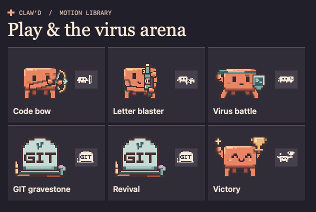

<p align="center"></p>

# Claw’d Companion

[Deutsch](../README.md) · [English](README.en.md) · **简体中文** · [हिन्दी](README.hi.md) · [Español](README.es.md) · [العربية](README.ar.md) · [Français](README.fr.md) · [বাংলা](README.bn.md) · [Português](README.pt.md) · [Bahasa Indonesia](README.id.md) · [اردو](README.ur.md)

一只住在桌面上的像素小螃蟹。Claude 需要你回应时，Claw’d 会从笔记本电脑前抬起头。平时它会盯着鼠标，或找个窗沿歇歇脚。

[**v0.6.0**](https://github.com/ZUMBYTE-AppSolution/clawd-companion/releases/tag/v0.6.0) · macOS · Windows · Linux · [Zumbyte · AppSolution](https://zumbyte.de/)

## 0.6.0 版新功能

除了 Mac 应用，现在也提供 Windows 和 Linux 桌面软件包。在“关于和更新”中可以检查新版本、阅读更新说明并挑选软件包。

[0.6.0 版新功能](releases/0.6.0/zh.md)

## 应用一览


| 悬浮层设置 | 连接 |
| --- | --- |
|  |  |

| 关于和更新 | 高分榜与竞技场账号 |
| --- | --- |
|  |  |

更新面板截图时未请求网络。高分榜截图使用原生排行榜界面，展示的是本地测试会话和示例成绩。

截图展示英文 Mac 界面，额度为示例数据。浏览器控制台画面是本地事件回放。 [↗](media/CAPTURES.md)

## 安装

macOS 13 或更高版本可以打开通用 PKG 安装包，也可以解压应用并拖入“应用程序”。在 Windows x64 上运行安装程序，或先解压便携 ZIP 再打开 EXE。Linux x86-64 可选择 DEB、RPM 或 tar 压缩包。发行页面列出了各平台已上传的文件。

Mac 版支持 Apple 芯片和 Intel 芯片。下文演示的窗口操作、权限设置和 Claude Code 连接方式以原生 Mac 应用为准。Linux 下的桌面功能也取决于窗口系统。

Windows 和 Linux 版使用 Qt。在 Windows 和 X11 下，Claw’d 能读取活动窗口的位置和大小，并固定在窗口上。Wayland 不提供窗口固定功能。此环境下自动空闲检测需要 GNOME IdleMonitor。无法获取空闲状态时，只有明确允许使用时游玩才能开始竞技场。

| OS | 安装 |
| --- | --- |
| macOS | [PKG](https://github.com/ZUMBYTE-AppSolution/clawd-companion/releases/download/v0.6.0/Clawd-Companion-0.6.0-macOS-universal.pkg) · [ZIP](https://github.com/ZUMBYTE-AppSolution/clawd-companion/releases/download/v0.6.0/Clawd-Companion-0.6.0-macOS-universal.zip) |
| Windows x64 | [Setup](https://github.com/ZUMBYTE-AppSolution/clawd-companion/releases/download/v0.6.0/Clawd-Companion-0.6.0-Windows-x64-Setup.exe) · [Portable ZIP](https://github.com/ZUMBYTE-AppSolution/clawd-companion/releases/download/v0.6.0/Clawd-Companion-0.6.0-Windows-x64-Portable.zip) |
| Linux x86-64 | [DEB](https://github.com/ZUMBYTE-AppSolution/clawd-companion/releases/download/v0.6.0/clawd-companion_0.6.0_amd64.deb) · [RPM](https://github.com/ZUMBYTE-AppSolution/clawd-companion/releases/download/v0.6.0/clawd-companion-0.6.0-1.x86_64.rpm) · [tar.gz](https://github.com/ZUMBYTE-AppSolution/clawd-companion/releases/download/v0.6.0/Clawd-Companion-0.6.0-Linux-x86_64.tar.gz) |

[SHA256SUMS](https://github.com/ZUMBYTE-AppSolution/clawd-companion/releases/download/v0.6.0/SHA256SUMS) · [GitHub Releases](https://github.com/ZUMBYTE-AppSolution/clawd-companion/releases)

**macOS · Homebrew**

```sh
brew tap zumbyte/clawd https://github.com/ZUMBYTE-AppSolution/clawd-companion
brew install --cask zumbyte/clawd/clawd-companion
```

**Debian / Ubuntu**

```sh
sudo apt install ./clawd-companion_0.6.0_amd64.deb
```

**Fedora / RHEL**

```sh
sudo dnf install ./clawd-companion-0.6.0-1.x86_64.rpm
```

## Claude 在忙什么

| 可见事件 | Claw’d 的反应 |
| --- | --- |
| Claude 正在写作或编辑 | 敲打小笔记本电脑的键盘。 |
| 规划、搜索或阅读 | 在白板上画计划，用放大镜查资料，或打开文件夹。 |
| 运行代码或制作作品 | 在迷你终端上操作，或在画架上画画。 |
| 工具请求授权 | 展开写着“OK?”的牌子，直到请求处理完毕。请在 Claude 中作答。 |
| Claude Code 报告有子代理在运行 | 用小代理玩偶表演杂耍。状态栏显示实际数量。 |
| 回答结束或出现警告 | 沿绳滑下，庆祝回答完成；收到警告时，用像素气泡显示原文。 |

## 连接 Claude.ai

在“连接”中开启浏览器连接。在 Chrome、Edge 或 Brave 中开启开发者模式，选择“加载已解压的扩展程序”，打开随附的 BrowserExtension 文件夹。把应用中的配对码粘贴到扩展程序弹窗中，然后重新加载 Claude.ai 标签页。Mac 版还附有 Safari 扩展，请启用它并允许访问 claude.ai。

在已配对的浏览器中打开用量页面。如果 Claude 显示会话或每周额度，Claw’d 就可以显示剩余百分比、重置时间和上次读取时间。相对时间为估算值，缺失或到期的读数会留空。扩展通过本地配对转发已打开标签页上可见的活动标签和通知。

[Claude.ai](https://claude.ai/settings/usage) · [Safari](https://developer.apple.com/documentation/safariservices/running-your-safari-web-extension)

### 在浏览器控制台试试像素气泡

在已配对的 Claude.ai 标签页中运行下例，页面会短暂显示一条提示，扩展会将提示传给 Claw’d。示例在本机运行，配图所示的浏览器流程也使用了演示事件。

```js
(() => {
  const notice = document.createElement("div");
  notice.setAttribute("role", "alert");
  notice.textContent = "Claw’d pixel bubble test";
  Object.assign(notice.style, {
    position: "fixed", top: "1rem", right: "1rem", zIndex: "2147483647",
    background: "#fff", color: "#222", padding: "0.75rem"
  });
  document.body.append(notice);
  setTimeout(() => notice.remove(), 4000);
})();
```


**Claude.ai → Claw’d · JSON**

```jsonl
{"type":"activity","state":"planning"}
{"type":"activity","state":"executing"}
{"type":"activity","state":"done"}
```

## 爬窗、追逐鼠标和病毒竞技场

在 Mac 上将 Claw’d 拖到窗口上，右键选择“Pin to Window”。它会随窗口移动，也可以从固定点沿绳滑下。散步时，它会爬上标题栏，四下张望、眨眼，再跳回桌面。它的眼睛会跟随鼠标。字母发射器每轮随机发射 3 至 42 发，每发都会重新瞄准。只有可见弹体碰到鼠标才算命中。

Mac 版在至少 90 秒没有输入后才会启动竞技场。Claw’d 有 100 点生命值。击退两波随机敌人后迎战首领。留意敌人的血条，收集治疗、护盾和速射道具。输入会暂停游戏；允许在使用电脑时游玩后，可以点击助战。战败后会留下刻着 GIT 的墓碑，现实时间五分钟后它会破土而出。音乐和各项音效可以分别开关。

在悬浮层设置中选择语言、减少动态效果并调节音量。各个音效可单独关闭。Claude.ai 通知保留原文。

## 高分榜与竞技场账号

高分榜汇总本机的得分、击败数、死亡次数、击败/死亡比和胜场。每局结束后，只有你亲自命中过敌人或捡到生效道具才会计入。要加入在线排行榜，请用用户名、邮箱和密码单独注册竞技场账号，在应用内登录并主动开始排位赛。服务器确认操作并计算成绩。排行榜展示用户名和游戏数据，邮箱保持私密。在线游玩需要能够连接游戏服务器。

## 动画图鉴

| 表情和游戏 | 窗口动作 |
| --- | --- |
|  |  |

| Claude 工具和授权 | 战斗、墓碑和复活 |
| --- | --- |
|  |  |


▶ [观看有声竞技场录像。影片缩短了守墓的五分钟。](media/virus-arena.mp4)

## 更新与本地开发

应用启动时会检查 GitHub 发行信息，之后每天检查一次。发现新版本时，点击提示即可查看更新说明并下载适合系统的软件包。

在“关于和更新”中检查新版本并选择软件包，下载后按上文方法安装。Mac 版的“连接”可以单独启用 Claude Code 活动钩子和额度读数，设置后请新开一个 Claude Code 会话。浏览器和终端各自保留读数。

Mac 应用使用 Swift 和 AppKit。安装 Xcode 后可在仓库根目录构建。JavaScript 测试使用本地浏览器测试数据。跨平台桌面客户端位于 Desktop 目录中。

```sh
./Scripts/build-mac.sh
swift test
node --test BrowserTests/*.test.js
python3 Scripts/test-hooks.py
```

[Swift](../Package.swift) · [Desktop](../Desktop/) · [Claude Code](https://code.claude.com/docs/en/hooks) · [Status line](https://code.claude.com/docs/en/statusline)

[Arena API](../Server/README.md) · [Windows](../Scripts/package-windows.ps1) · [Linux](../Scripts/package-linux.sh)

## 工作室与社区

Andreas Zumbansen 在德国卡门经营 Zumbyte · AppSolution。这家独立工作室开发移动和桌面应用，也为企业和团队定制软件。

Zumbyte · AppSolution · Kastanienallee 16a · 59174 Kamen · DE · +49 177 4149667

[Zumbyte](https://zumbyte.de/) · [法律声明](https://zumbyte.de/impressum/) · [info@zumbyte.de](mailto:info@zumbyte.de)

向所有用 AI 编程的朋友问好。感谢大家一起开发、分享经验、互相帮助！
